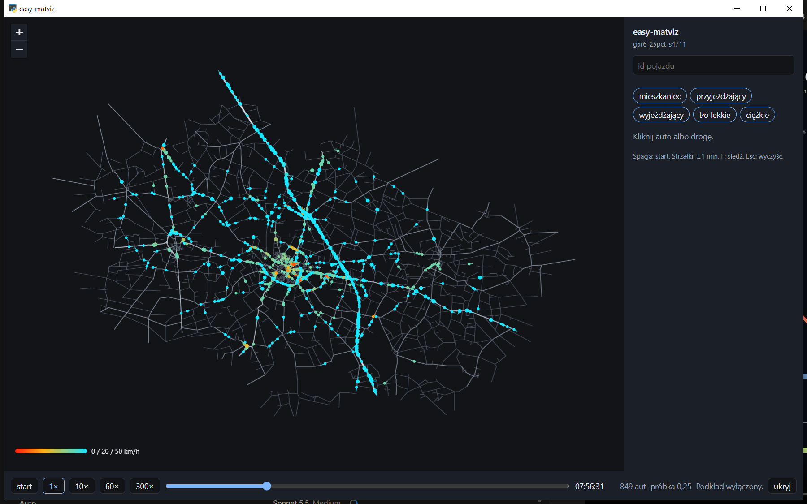
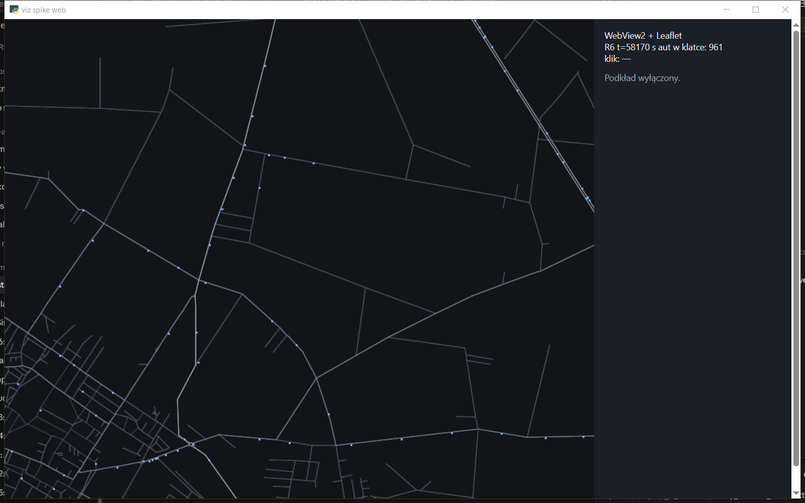

# Wizualizer — plan wdrożenia

Data: 2026-10-20. Plan lokalny. Nie jest fazą w `TASKS.md`. Recenzja faktów: `wizualizer_recenzja.md`.

## Wybór użytkownika (2026-10-20)

Michał wybrał w formularzu 2026-10-20. Wpis jest w `docs/projekt/DECISIONS.md` jako **D24**: faza po zamkniętym MVP, bez otwierania MVP i bez zastępowania G5/D23. Krok 1 (indeks) jest w `pipeline/viz_index.py`. Krok 2 (silnik klatki) jest w `pipeline/viz_engine.py`. Spike stosu (2026-10-20) zostawił WebView2 + Leaflet. Krok 3 (okno) jest w `viz_player/`. Akceptacja automatyczna przeszła 2026-10-20. Akceptacja ludzka obrazu jest otwarta. Klucza CARTO nadal nie ma. Z kroku 4 jest oś harmonogramu w panelu.

| punkt | wybór |
|---|---|
| 1 | Kod po wpisie w `DECISIONS.md` |
| 2 | Lokalny player z inspekcją. Blender zostaje do filmów, SimWrapper do dashboardów |
| 3 | v1: mapa, czas, szukanie, klik auta, klik linku, pięć klas, lista czynności. Bez dwóch runów i bez wykresu doby |
| 4 | Spike zmierzony 2026-10-20: zostaje WebView2 + Leaflet. Okno jest w `viz_player/`. Akceptacja ludzka otwarta |
| 5 | Rzadki indeks całego runu w `output/`. Gęsty `vehicles.npz` zostaje przy Blenderze |
| 6 | Indeks całego `output/g5r6_25pct_s4711`. Player otwiera się o 06:00 |
| 7 | Pięć klas (`r`, `c`, `o`, `t`, `h`), na starcie wszystkie włączone. Kolor auta = prędkość |
| 8 | Cięciwy sieci, kolor według atrybutu `type` |
| 9 | Prosty ciemny podkład OSM (kafelki). Nazw ulic nie trzeba. Szczegół niżej |
| 10 | Rysować tyle aut, ile jest w runie. Ułamek z `sampleSize` |
| 11 | Indekser w `pipeline/`, player osobno. Java bez zmian. `g6_bake.py` nietknięty, aż test 0,5 m przejdzie i będzie osobne zlecenie spięcia |

Punkt 9 jest doprecyzowaniem słów użytkownika: „na razie prosty podkład OSM, może Leaflet albo kafelki OSM, ciemny motyw, nazw ulic nie musi być”. Recenzja zalecała v1 bez podkładu. Ten wybór ją uchyla.

## Po co jest v1

Otworzyć gotowy run na tym komputerze, puścić czas, znaleźć pojazd, kliknąć pojazd albo link, wyłączyć warstwę (tło, ciężkie, pracujący). Nic nie liczyć w MATSim i nic do niego nie zapisać.

Maszyna: 16 GB RAM, Windows, Python 3.12 (`uv`), Java 25 tylko do symulacji. Budżet pamięci playera: 2–4 GB. Run, na którym plan jest sprawdzony liczbami: `output/g5r6_25pct_s4711`.

## Czego brakuje do odtwarzacza

1. Wybór punktów 1–11 i wpis D24: zrobione.
2. Krok 1, indeks: zrobione 2026-10-20 (`pipeline/viz_index.py`). Pliki leżą w `output/g5r6_25pct_s4711/viz/` i są poza gitem.
3. Krok 2, silnik klatki: zrobione 2026-10-20 (`pipeline/viz_engine.py`). Na R6 w szczycie 961 aut, bez `t` 420.
4. Spike stosu okna (punkt 4): zmierzony 2026-10-20. Zostaje WebView2 + Leaflet. Kod spike'u leży w `output/viz_spike/` i jest poza gitem. Okno (krok 3) jest w `viz_player/`. Została akceptacja ludzka obrazu.
5. `pywebview` jest w `pyproject.toml`. Leaflet 1.9.4 leży w `viz_player/vendor/` (powłoka, nie zamek zależności). `PySide6` nie wchodzi. Indekser dalej mieści się w `numpy`, `lxml`, `zstandard`, `pyproj`.
6. Klucz CARTO do kafelków `dark_nolabels`. Bez niego v1 rysuje sieć na ciemnym tle. Klucza nie wklejać do gita.

Dane do pierwszej wersji są. Eventy, sieć i `sampleSize` 0,25 leżą w runie R6. Runu D16, z którego wzięto 4 822 / 755, na dysku nie ma. Nazw ulic w sieci nie ma i v1 ich nie dociąga.

## Spoza v1

Łamane OSM, budynki, pasy, dźwięk, zapis zwrotny, dwa runy obok siebie, wykres całego dnia, select-link historyczny (wszystkie auta, które kiedykolwiek były na linku), OTFVis, dekompilacja Via, gęsta tablica klatek w playerze, zmiana `matsim/`, zmiana `g6_bake.py` w tym samym kroku co pierwsze okno. Nazwy ulic. Kafelki z `tile.openstreetmap.org`. Pobieranie kafelków hurtowo albo do trybu offline.

## Architektura

Trzy kawałki. Dwa pierwsze są niezależne od stosu okna.

```
output/<run>/output_events.xml.zst
output/<run>/output_network.xml.zst
output/<run>/output_config.xml
        |  jeden przebieg, pipeline/viz_index.py
        v
output/<run>/viz/index.npz
output/<run>/viz/meta.json
        |  odczyt bez XML
        v
silnik (NumPy): klatka(t) -> tablice aktywnych
        |  tylko bieżąca klatka i wynik kliknięcia
        v
okno: mapa, pasek czasu, szukanie, panel
```

Java bez zmian. Blender dalej czyta swój `vehicles.npz`.

Semantyka pozycji jest kopią `g6_bake.py`, z jednym dodatkiem: na węźle zostaje indeks linku.

- `vehicle enters traffic`: punkt na linku wg `relativePosition` (brak atrybutu = 1, jak bake). Czas, współrzędne względem originu, indeks linku, długość do prędkości = 0.
- `entered link`: początek linku (węzeł from), długość 0.
- `left link` i `vehicle leaves traffic`: koniec linku (węzeł to), długość = atrybut `length` linku.
- Prędkość na odcinku między węzłami: jeśli długość końca > 0, to długość / dt, inaczej odległość euklidesowa / dt. Sufit 30 m/s, jak bake.
- Kierunek: `atan2(dy, dx)`. Odcinek zerowy dziedziczy poprzedni kierunek.
- Pozycja w czasie t: liniowo między węzłami, których czasy obejmują t. Widoczny tylko w [pierwszy węzeł, ostatni węzeł] przejazdu.
- Origin: `(524805.0, 485023.0)` EPSG:2180, x = wschodzenie, y = północ. Ten sam co G6. W pliku zapisany, nie tylko w kodzie.
- Współrzędne w indeksie: float32 metry względem originu. Przy współrzędnej bezwzględnej ~525 000 float32 ma krok około 6 cm. Względem originu krok jest drobny, a test 0,5 m ma zapas.

`walk`, `departure`, `arrival`, `PersonEntersVehicle` nie tworzą węzłów jazdy. `actstart` i `actend` idą do osobnej tabeli, gdy `actType` jest inny niż `car interaction`.

Klasa z pierwszego znaku id pojazdu:

| znak | klasa | kto to jest w `plans.py` |
|---|---|---|
| `r` | mieszkaniec | `resident` |
| `c` | przyjeżdżający | `commuter` |
| `o` | wyjeżdżający | `outbound` |
| `t` | tło lekkie | prefiks `t`, subpopulation `tlo` |
| `h` | ciężkie | prefiks `h`, subpopulation `ciezkie` |
| inny | inne | widać na mapie, filtr nie gubi po cichu |

## Format `index.npz`

Jeden plik, `np.savez_compressed`. Drugie otwarcie przy zgodnym sha256 eventów i sieci nie parsuje XML.

Meta w `meta.json` (tekst, da się go przeczytać bez NumPy):

- `events_sha256`, `network_sha256`, `events_bytes`, `network_bytes`
- `origin` [524805, 485023], `crs` `EPSG:2180`
- `sample_size` z `output_config.xml`, odczyt jak `convergence.sample_size` (pierwsze `name="sampleSize"`). Brak: `null`
- `t_min`, `t_max` z danych, nie z configu
- `n_tracks`, `n_knots`, `n_links`, `max_concurrent`, czas budowy
- `class_legend` i `type_legend` (słownik kod → nazwa)
- `source_run` jako nazwa katalogu, nie ścieżka `C:\Users\...`

Tablice:

- `link_id` Unicode, `link_xy` float32 `(L, 4)` = x0, y0, x1, y1 względem originu, `link_length` float32, `link_freespeed` float32, `link_type` uint8 (legenda w meta)
- `track_id` Unicode `(N,)`, `track_class` uint8, `track_t0` float32, `track_t1` float32, `knot_off` int64 `(N+1,)`
- `knot_t` float32, `knot_x` float32, `knot_y` float32, `knot_len` float32, `knot_link` int32 — wycinki wg `knot_off`
- `bucket_sec` = 60, `bucket_t0` float32, `bucket_off` int64, `bucket_track` int32 — lista numerów przejazdów aktywnych w kubełku
- `act_id` indeks do tej samej tablicy identyfikatorów co `track_id` (wspólny słownik `ids`), `act_t` float32, `act_kind` uint8 (0 koniec, 1 start), `act_type` uint16 + legenda, `act_link` int32, `act_x`, `act_y` float32

Słownik `ids` jest jeden. Przejazd i czynność wskazują w niego indeksem, jeśli Unicode na każdy przejazd zacznie ważyć więcej niż treść. Przy 29 660 przejazdach i krótkich id różnica jest mała. v1 może zostać przy `track_id` Unicode. Aktywności i tak potrzebują id, więc wspólny słownik jest w specyfikacji od razu (`ids` + `track_id_i` int32). Nie zmieniać tego w połowie, gdy dojdzie doba 100%.

Rozmiar orientacyjny R6 25%, cały plik: węzły ~76 MB surowe, linki < 1 MB, kubełki kilka MB, identyfikatory kilka MB. Po kompresji npz mniej. Budżet akceptacji: plik < 200 MB i wczytanie do RAM < 1 GB. Jak wyjdzie więcej, najpierw zmierzyć, potem gęstość kubełka, a nie wracać do tablicy klatka × auto.

Kubełek 60 s: przejazd wpada do każdego kubełka, który przecina `[track_t0, track_t1]`. Skok suwaka bierze kubełek i ustawia kursor `searchsorted` tylko tym przejazdom. Odtwarzanie do przodu trzyma kursor i przesuwa go monotonicznie. Koszt klatki jest rzędu liczby aut w sieci (tu szczyt 961), nie rzędu 29 660.

## Silnik

Moduł bez okna, importowalny. Funkcje:

- `load(run_dir) -> Index`. Buduje albo czyta `viz/`.
- `frame(index, t, classes_on) -> Frame` z tablicami float32: `xy (A,2)`, `heading (A,)`, `speed (A,)`, `link (A,) int32`, `cls (A,) uint8`, `track (A,) int32`. `A` = aktywni po filtrze.
- `pick_vehicle(frame, xy_screen_to_world, px_tolerance_m) -> track | None`. Najbliższy w metrach przeliczonych z 8 pikseli przy bieżącym zoomie.
- `pick_link(index, world_xy, px_tolerance_m) -> link | None`. Najbliższa cięciwa. 10 383 odcinków liczone w kliknięciu, nie w każdej klatce.
- `link_now(frame, link) -> {n, speed_mean, speed_median}`.
- `lookup(index, query) -> lista id`. Najpierw dokładne trafienie, potem prefiks, najwyżej 20. Jedno id zwraca wszystkie przejazdy i czynności.
- `activities(index, id) -> lista po czasie`.

Zegar symulacji jest niezależny od Hz okna. Mnożniki: 1×, 10×, 60× (1 s filmu = 1 min), 300×. Suwak ustawia czas bezwzględny. Zakres suwaka = `[t_min, t_max]` z meta, z podpisem godzin powyżej 24 jako `30:12`, nie jako rzut na dobę.

Pamięć: po `load` trzyma tablice NumPy, nie listę obiektów Pythona na węzeł. Klatka alokuje bufor na `max_concurrent` i wypełnia prefiks. Drugi run: `load` zwalnia poprzedni indeks.

## Podkład (punkt 9)

Prosty, ciemny, bez nazw. Leaflet i kafelki rastrowe, nie własny renderer mapy.

Warstwa: CARTO Dark Matter bez podpisów.

`https://{s}.basemaps.cartocdn.com/rastertiles/dark_nolabels/{z}/{x}/{y}.png?key=…`

`{s}` to `a`–`d`. Źródło składni: dokumentacja CARTO Basemaps (stan stron carto.com na 2026-10-20). Raster wymaga klucza. Klucz jest darmowy do progu opisanego u CARTO (użycie niekomercyjne do 5 mln kafelków na miesiąc; próg komercyjny jest niższy). Klucz bierze użytkownik na `https://carto.com/basemaps/apikey` i trzyma lokalnie, poza gitem (propozycja pliku: `config/viz_basemap.local.toml`, dopisany do `.gitignore`, kiedy kod ruszy). W repozytorium klucza nie ma.

Na mapie zostaje widoczna atrybucja: © OpenStreetMap contributors, © CARTO. Bez tego darmowy próg nie obowiązuje.

`tile.openstreetmap.org` odpada. Kafelki są jasne, z nazwami w rasterze, a polityka OSMF nie jest przeznaczona na aplikację, która woła ich serwer jako domyślny podkład. Hurtowe ściąganie powiatu też odpada, u OSMF i tu: player prosi tylko o kafelki widoku, cache zostawia przeglądarce.

Leaflet (biblioteka, którą użytkownik wymienił) trzyma kafelki w EPSG:3857. Indeks zostaje w metrach EPSG:2180 względem originu. Zamiana na długość i szerokość jest w playerze, raz na link przy wczytaniu (10 383 odcinków) i co klatkę na aktywne auta (szczyt 961). Robi to `pyproj`, już w `pyproject.toml`, z `always_xy=True`: na wejściu x = wschodzenie, y = północ. Do Leaflet idą pary szerokość, długość. Test: środek Kutna (około 525 km E, 485 km N) ląduje koło 52,24° N, 19,36° E. Jak wyjdzie w Afryce, zamienione są osie.

Brak klucza albo brak sieci: player działa dalej. Zostają cięciwy na tle `#121418` i jedno zdanie w pasku, że podkład jest wyłączony. Brak kafelka nie blokuje inspekcji.

Nazw ulic nie rysujemy. Wariant `dark_nolabels` ich nie ma w obrazku. Id linku i typ drogi są w panelu po kliknięciu.

Auta i cięciwy to jedna warstwa canvas nad kafelkami, nie osobny `CircleMarker` na pojazd. Tysiąc znaczników DOM-owych Leaflet przy 30 Hz nie jest lekkością, o którą chodzi.

## Okno (po spike'u)

Jeden widok. Mapa zajmuje prawie całe okno. Po prawej panel około 320 px, chowany. Na dole pasek: play, mnożnik, suwak, zegar, liczba aut w kadrze, `sampleSize`.

Zachowanie:

- Otwórz katalog runu. Brak eventów albo sieci: zdanie w panelu, co brakuje.
- Start na 06:00:00, pauza, widok na całą sieć.
- Spacja: play/pauza. Strzałki: ±60 s. `f`: śledzenie wybranego auta (kamera północą do góry, auto w środku). Escape: czyści wybór i śledzenie.
- Klik w auto: panel pokazuje id, klasę, prędkość km/h, id linku, typ drogi, freespeed. Mapa podświetla ten przejazd (dotychczasowa cięciwa od `t0` do teraz).
- Między nogami, gdy id ma czynność obejmującą `t`: panel pisze typ czynności i link, mapa nie rysuje ducha na drodze.
- Klik w link, gdy auto nie leży w tolerancji: panel pokazuje id, typ, długość, freespeed, ile aut jest na nim teraz i jaka jest ich średnia prędkość.
- Pięć chipów klas. Domyślnie wszystkie. Chip `inne` widać tylko, gdy taka klasa w indeksie jest.
- Szukanie: Enter na dokładnym id śledzi. Wiele trafień: lista w panelu.
- Kolor auta: rampa G6 (`g6_load.py`, vmax 14 m/s). Legenda na mapie: 0 / 20 / 50 km/h.
- Kolor drogi wg `type`, przygaszony, żeby nie bił się z prędkością. `motorway` jaśniejszy niż `residential`. `boundary_turnaround` ledwo widoczny.
- Grubość drogi i glif auta w pikselach, nie w metrach świata. Ciężkie (`h`) około 1,4× glif osobowego. Z widoku powiatu auta mają zostać kropkami, nie zniknąć.
- Ciemny motyw od pierwszej klatki. Tło pod kafelkami i panel: `#121418` / `#1b1f27`, tekst `#e7e9ee`, drugi plan `#9aa3b2`, akcent `#7eb6ff`. Cięciwy nad kafelkiem są cieńsze i jaśniejsze niż sam podkład, żeby A1 nie zginęła w Dark Matter: motorway `#d5dde6`, primary `#aeb6c2`, secondary/tertiary `#7d8694`, reszta `#4e5663`. To umowa wyglądu v1, do poprawki po pierwszym obejrzeniu.
- Czcionka systemowa Segoe UI (ta sama, której używa G6 story). Polskie znaki w podpisach klas.
- HiDPI: współrzędne kliknięcia w pikselach logicznych, zanim pójdą na metry.

Okno nie trzyma trajektorii. Dostaje `Frame` i geometrię sieci raz.

### Spike stosu (pół dnia, gitignored)

Podkład z punktu 9 jest mapą w przeglądarce. Spike ma to uwzględnić, inaczej porówna dwie puste ramki.

Dwie minimalki. Ta sama klatka: sieć R6 (albo 5 000 punktów, jeśli sieć jeszcze bez indeksu) plus kafelki `dark_nolabels` na wycinku Kutna, ruch 30 Hz, jeden klik zwraca indeks punktu. Klucz CARTO tylko w pliku lokalnym.

1. WebView2 i Leaflet: kafelki pod spodem, auta na canvasie, do widoku jeden bufor binarny na klatkę (współrzędne WGS84 albo piksele już przeliczone). Jeśli wiązanie umie tylko JSON albo `evaluate_js` na każdy punkt, wariant odpada bez strojenia. JSON jednej tablicy 1 000 punktów na klatkę jeszcze wolno zmierzyć i zapisać liczbę. Jak spada poniżej 15 Hz, odpada.
2. PySide6: ten sam kafelek (pobrany do widgetu) albo uczciwy napis, że kafelki w Qt są osobną biblioteką. Mapa i panel w jednym procesie, arkusz z kolorów wyżej.

Zostaje wariant, który: trzyma proces okna wyraźnie poniżej 1 GB, klika w poniżej 50 ms, pokazuje ciemny podkład z atrybucją i da się ostylować bez wyglądu debuggera. Wynik (trzy liczby i jeden zrzut) dopisać na końcu tego pliku. Dopiero potem program v1.

Po wyborze podkładu typ przed pomiarem przesuwa się na wariant 1. Leaflet jest dokładnie tym, o co chodziło w punkcie 9. Qt zostaje w spike'u, bo lekkość klatki nadal jest wymaganiem i WebView2 może ją oblać.

## Kolejność prac

Każdy krok ma test. Krok bez testu nie jest skończony. Runu dłuższego niż sam odczyt eventów tu nie ma. Odczyt R6 (4,3 mln linii) jest budżetem rzędu minuty do dwóch; jak przekroczy 5 min, przerwać i uprościć parser, nie dokładać okna.

### Krok 0. Wpis D

Zrobione: D24 (2026-10-20). Faza po zamkniętym MVP. Osobne repo odłożone.

### Krok 1. Indeks

`uv run python pipeline/viz_index.py output/g5r6_25pct_s4711`

Stan 2026-10-20: zrobione. Akceptacja poniżej przeszła na R6. Dowód: `docs/projekt/PROGRESS.md` i `output/g5r6_25pct_s4711/viz/index.log`.

Akceptacja na tym runie, liczby z pomiaru 2026-10-20:

- 29 660 przejazdów
- 6 641 wjazdów (`vehicle enters traffic`) o czasie w [21 600, 32 400]
- szczyt jednoczesny 961 i szczyt w oknie 6–9 równy 849 (tolerancja 0; to licznik eventów, nie estymacja)
- każda klasa z piątki ma choć jeden przejazd
- plik `viz/index.npz` < 200 MB
- drugi start przy tym samym sha kończy się bez pełnego skanu (log: `reuse`)
- stdout i czas lądują w `output/<run>/viz/index.log`

Test geometrii, ten sam próg co G6: seed 1, trzy przejazdy o więcej niż 8 węzłach, osobny odczyt eventów buduje sekwencję linków, 20 chwil wewnątrz każdego przejazdu, odległość pozycji silnika od odcinka linku < 0,5 m. Assert w skrypcie, kod wyjścia ≠ 0 przy porażce. To zastępuje test bake'u D16, którego plików nie ma.

### Krok 2. Silnik bez okna

`uv run python pipeline/viz_engine.py output/g5r6_25pct_s4711`

Stan 2026-10-20: zrobione. Akceptacja poniżej przeszła na R6. Dowód: `docs/projekt/PROGRESS.md` i `output/g5r6_25pct_s4711/viz/engine.log`.

Testy na indeksie z kroku 1, bez rysowania:

- w czasie równym węzłowi pozycja = współrzędne węzła (float32, 1 mm)
- auto niewidoczne przed `track_t0` i po `track_t1`
- filtr bez `t` zmniejsza liczbę aktywnych o czasie szczytu; filtr pełny daje liczbę zgodną z przebiegiem enter/leave
- `lookup` dokładnego id z próbki (pierwszy `r…` z pliku) zwraca jego przejazdy
- `pick_vehicle` na współrzędnej tego auta zwraca jego track
- `activities` dla id, które ma `actType=home`, zwraca wpis `home` i nie zwraca `car interaction`

### Krok 3. Okno

Stan 2026-10-20: kod zrobiony (`viz_player/`). Akceptacja automatyczna przeszła: self-testy kroków 1–2, self-test okna, check R6 i smoke okna. Po pierwszej inspekcji: przycisk panelu zostaje na pasku, a kolejne uruchomienie po krzyżyku znowu rysuje klatkę (lekcja 28). Akceptacji ludzkiej agent nie zalicza. Dowód: `docs/projekt/PROGRESS.md`, `output/g5r6_25pct_s4711/viz/player.log`, zrzut niżej (to smoke o 07:56, nie otwarcie programu; program wstaje o 06:00).

Akceptacja automatyczna: kroki 1–2 nadal przechodzą, import okna nie czyta XML.

Akceptacja ludzka (tej części agent nie zalicza sam):

- otwarcie R6, pauza o 07:56, widać rząd setek aut, nie pustą mapę
- play, suwak wstecz do 06:30, z powrotem do przodu, bez ponownego czytania eventów
- szukanie id, śledzenie, Escape
- wyłączenie `t` wyraźnie rozrzedza obraz
- klik linku pokazuje liczbę > 0 na drodze, na której widać auta
- panel czytelny, ciemny, mapa dominuje
- podpis próbki `0,25`
- ciemne kafelki pod siecią, bez nazw ulic, z atrybucją OSM i CARTO; przy braku klucza widać samą sieć i zdanie o wyłączonym podkładzie

Poprawki wyglądu po tym obejrzeniu są częścią kroku 3, nie nową fazą.

Zrzut smoke, pauza 07:56:31, 849 aut, podkład wyłączony. To nie jest akceptacja ludzka:



### Krok 4. Dopiero potem, każda rzecz osobno

Stan 2026-10-20: pierwsza rzecz jest w panelu wybranego id. Oś czasu zastępuje listę czynności. Odcinek czynności bierze się z `actstart`/`actend`, jazda z przejazdów i wycina czynność. Zakres osi to `[t_min, t_max]`. Klik ustawia czas. Dziury między czynnością a jazdą to dojście, którego indeks nie rysuje (`car interaction`). To nie jest wykres natężenia doby.

Akceptacja automatyczna: self-test osi (dom–jazda–praca–jazda–dom, jazda wycina czynność), check R6 (`r6510903_5` ma 5 odcinków, jeden zaznaczony), smoke widzi pasek osi w oknie. Dowód: `docs/projekt/PROGRESS.md`.

Reszta kroku 4 czeka na własny wpis, bo rusza zakres: łamane OSM w konwerterze (Java), podkład z licencją (klucz CARTO), drugi run, spięcie bake'u, Łódź.

## Ryzyka

| ryzyko | co widać | co wtedy |
|---|---|---|
| Parser linii regexem gubi atrybut | test 0,5 m pada | czytać te cztery typy przez `iterparse`, wolniej, poprawnie |
| Sha256 dwóch plików przed każdym otwarciem trwa długo | log > 5 s samego hasha | hash raz, trzymać rozmiar i mtime jako skrót, pełny sha przy budowie |
| Okno webowe kopiuje JSON | spike > 1 GB albo < 15 Hz | odrzucić wariant, zostać przy Qt |
| Qt wychodzi szary | pierwszy zrzut | arkusz z tego pliku jest kryterium kroku 3, nie opcją |
| Klucz CARTO w repo albo w logu | przegląd diffu | klucz tylko w pliku lokalnym z `.gitignore`. Bez klucza player rysuje samą sieć |
| Kafelki OSM.org jako skrót | URL `tile.openstreetmap.org` | nie używać. Jasne, z nazwami, polityka serwera nie jest na ten program |
| Osie podkładu | Kutno wychodzi poza Polskę | `pyproj` `always_xy=True`, test punktu 52,24° N, 19,36° E |
| Dobowy indeks R6 100%, gdy powstanie | plik > 200 MB | rzadki format zostaje; podnieść budżet po pomiarze, nie zmieniać układu tablic |
| Nowy prefiks id w kolejnym wariancie planów | klasa `inne` niepusta | dopisać legendę, nie zgadywać litery w oknie |
| Film G6 i player pokazują inny korek | ten sam pojazd, inna pozycja o 08:00 | porównać z testem 0,5 m; poprawia ten, który test oblewa. Bake nie ruszać „przy okazji” |

## Uruchomienie

Z katalogu projektu, tym samym `uv` co reszta pipeline:

```
uv run python pipeline/viz_index.py output/g5r6_25pct_s4711
uv run python pipeline/viz_engine.py output/g5r6_25pct_s4711
uv run python -m viz_player output/g5r6_25pct_s4711
```

Trzecie polecenie otwiera okno. Indekser, silnik i okno są w gicie (`pipeline/viz_index.py`, `pipeline/viz_engine.py`, `viz_player/`). Katalog `viz_player/` stoi obok `pipeline/`, bez Javy.

Log indeksu: `output/<run>/viz/index.log`. Log silnika: `output/<run>/viz/engine.log`. Okno zapisuje ostatni otwarty run w `output/viz_player_state.json` (też pod `output/`, już ignorowane). Bez zapisu do `scenarios/` i bez zapisu do `data/raw/`.

## Definicja „gotowe do wdrożenia”

Gotowe jest: wybór 11 punktów, D24, format, testy, kolejność, budżet, miejsce plików, wygląd pierwszej klatki, podkład (Leaflet, CARTO `dark_nolabels`), krok 1 (indeks R6), krok 2 (silnik klatki), spike stosu (WebView2 + Leaflet, liczby niżej), krok 3 w kodzie (okno, `pywebview`, Leaflet w `viz_player/vendor/`) i jego akceptacja automatyczna. Niegotowe, świadomie: akceptacja ludzka obrazu, klucz CARTO.

Bez klucza okno rysuje sieć na `#121418` i zdanie o wyłączonym podkładzie. Z kroku 4 jest oś harmonogramu. Łamane OSM, podkład z kluczem, drugi run, spięcie bake'u i Łódź zostają osobno.

## Spike stosu, pomiar 2026-10-20

Kod został w `output/viz_spike/` i nie wchodzi do gita. Ta sama klatka: `output/g5r6_25pct_s4711`, t = 58 170 s, 961 aut, 8 362 cięciwy w kadrze, 30 klatek co sekundę. Osie: 524 805 E, 485 023 N wychodzą jako 52,2307° N, 19,3633° E (`pyproj`, `always_xy`).

Kafelki: URL CARTO `dark_nolabels` bez klucza. Klucza w repozytorium nie ma. Serwer oddał HTTP 200 i 35 razy ten sam PNG, 2 513 B, z napisem API KEY REQUIRED. To nie jest mapa. Oba warianty narysowały cięciwy na `#121418` i zdanie „Podkład wyłączony.” Podkładu ten pomiar nie obejmuje. `tile.openstreetmap.org` nie był użyty.

Hz to tempo 30 Hz przez 2 s (ukończone klatki podzielone przez czas), nie pętla na maksimum. Oba warianty tempo utrzymały. Klik Qt to `QTest.mouseClick` w piksel auta 0. Klik WebView2 to jedno `evaluate_js` z `pickAt`. Oba zwróciły indeks 0. RAM to working set procesu i potomków. PowerShell na tym komputerze wypisuje przecinek (`526,9`); parser liczby musi go przyjąć.

| wariant | Hz | klik, ms | RAM, MB |
|---|---:|---:|---:|
| PySide6 | 29,56 | 0,24 | 165 |
| WebView2 + Leaflet | 29,22 | 0,92 | 503 |

Powtórka tego samego dnia, bo przy pierwszym pomiarze w RAM siedziały inne programy. Przed powtórką, przez 2 s, maszyna (12 rdzeni logicznych) zużyła 5,8 s CPU z 24 dostępnych, głównie `dllhost` i VS Code. Spike'i poszły jeden po drugim, żaden nie został w tle. Wynik powtórki:

| wariant | Hz | klik, ms | RAM, MB |
|---|---:|---:|---:|
| PySide6 | 29,70 | 0,24 | 165 |
| WebView2 + Leaflet | 29,58 | 0,65 | 503 |

WebView2 dostał jedną tablicę JSON (961 punktów) na klatkę, jednym `evaluate_js`. Progi z tego pliku (poniżej 15 Hz, powyżej 1 GB, klik powyżej 50 ms) nie zostały przekroczone ani razu. PySide6 też je mieści. Do dalszej implementacji zostaje WebView2 + Leaflet: plan już tam stał, powtórka dała te same rzędy liczb, waga klatki się utrzymała. Ciemnego podkładu z atrybucją nie pokazał żaden wariant, bo nie ma klucza. Po tym pomiarze powstało okno v1 w `viz_player/` (`pywebview` w `pyproject.toml`, bez `PySide6`). Akceptacja ludzka obrazu zostaje otwarta.

Zrzut WebView2 (HiDPI, widoczna część kadru, podkład wyłączony):


