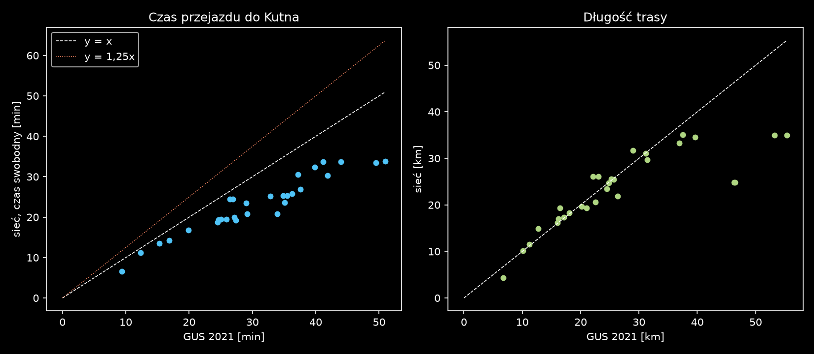

# G5: dane do walidacji modelu i ruchu tła

Data: 2026-10-17. Etap 2a (zbieranie danych). **Nie zmieniałem modelu ani nie uruchamiałem MATSim.** Plik jest generowany przez `pipeline/g5_doc.py` z szablonu `reports/etap2/g5_walidacja/szablon.md`; tabele liczą skrypty `pipeline/g5_gpr.py`, `g5_gus_czasy.py`, `g5_mapa.py`.

## 0. Wnioski w skrócie

1. **GPR 2025 (GDDKiA) jest dostępny i wystarcza** do walidacji natężeń na drogach krajowych i wojewódzkich. Nowszy niż 2020/21, więc 2020/21 nie pobierałem. W obszarze naszej sieci jest **19 odcinków pomiarowych** (3× A1, 11× DK, 5× DW). Wszystkie mają przypisane linki (oba kierunki), tabela w §1.3, mapa `reports/etap2/g5_walidacja/gpr_mapa.png`.
2. **Brak publicznych danych dla ulic Kutna poza drogami krajowymi.** Nie znalazłem pomiarów miejskich (UM, ZDM, plan transportowy). Przez miasto przechodzi DK60/DK92, więc Sklęczkowska, Objazdowa i ul. Bitwy pod Kutnem są w GPR. Drogi miejskie i powiatowe trzeba wyprosić od zarządców (§2).
3. **„Płatna A1” w Kutnie nie istnieje.** Odcinek Toruń–Stryków jest bezpłatny dla aut osobowych, a opłata e-TOLL dotyczy pojazdów > 3,5 t. Natężeń na węźle Kutno nie ma w źródłach publicznych poza GPR (§2).
4. **Godzinowy profil z GPR nie istnieje.** GPR daje tylko udziały 6–18 / 18–22 / 22–6. Godzinowe krzywe są na wykresach stacji ciągłej 14005 Lisica (DK60c, 13 km od Kutna) i wymagają digitalizacji (§1.4).
5. **Ruch tła: rekomendacja to agenci wjazd–wyjazd na granicy sieci**, z natężeniem z GPR pomniejszonym o to, co model już generuje (§3).
6. **Prędkości D13 nie są za niskie względem GUS.** Czas swobodny w sieci to mediana **0,76 × czas GUS** (sieć szybsza o ok. 24%), przy zgodnej długości tras (§4). Nie ma sygnału do podnoszenia prędkości.

## 1. GPR 2025 (Generalny Pomiar Ruchu, GDDKiA)

### 1.1. Co jest i skąd

Strona: <https://www.gov.pl/web/gddkia/generalny-pomiar-ruchu-2025>. Pobrane do `data/raw/g5/gpr2025/` (sha256 w §6).

| plik | zawartość |
|---|---|
| `dk_wykaz.xlsx` | wykaz odcinków pomiarowych dróg krajowych: numer odcinka, pikiety, współrzędne punktu pomiarowego (lat/lon i X/Y) dla jezdni prawej i lewej, rejon GDDKiA |
| `dk_sdrr.xlsx` | SDRR (średni dobowy ruch roczny, pojazdy silnikowe) + **struktura rodzajowa** (motocykle, osobowe, mikrobusy, lekkie ciężarowe, ciężarowe bez/z przyczepami, autobusy, ciągniki) + **struktura kierunkowa** (udział jezdni lewej/prawej) |
| `dk_sdrdr.xlsx`, `dk_sdrl.xlsx` | to samo dla dni roboczych (SDRDR) i lata lipiec–sierpień (SDRL) |
| `dk_odcpom_web.zip` | SHP odcinków (EPSG:2180, linie) z SDRR/SDRDR/SDRL, 2 424 odcinki |
| `dw_wykaz.xlsx`, `dw_sdrr.xlsx` | drogi wojewódzkie (zmierzone przez zarządców, w tym ZDW Łódź, metodą GDDKiA): tylko SDRR i struktura rodzajowa, bez kierunków i bez SDRDR |
| `ruch_drogowy_2025.pdf`, `rozklady_srodowiskowe.pdf`, `dw_synteza.pdf` | opisy, rozkłady w okresach doby |

- GPR jest wykonywany co 5 lat; w 2025 pomiar był automatyczny lub z wideorejestracji (ok. 2,4 tys. odcinków krajowych). GDDKiA **nie udostępnia danych z pojedynczych dni pomiarowych**, tylko średnie roczne. Dane godzinowe z GPR nie są publikowane.
- Wartość z tabeli jest **reprezentatywna dla całego odcinka pomiarowego** (między węzłami), nie dla punktu. Punkt pomiarowy służy tylko do przypisania do linku.
- Wersja GPR 2020/21 (drogi wojewódzkie opublikowane 11.01.2022) istnieje (<https://www.gov.pl/web/gddkia/wyniki-generalnego-pomiaru-ruchu-202021-na-drogach-wojewodzkich>), nie pobierałem. Do analizy trendu można dociągnąć.
- Współrzędne: kolumny „X/Y” GDDKiA są podpisane odwrotnie względem konwencji (Y = północ). Dlatego `g5_gpr.py` bierze **lat/lon i transformuje do EPSG:2180 (E, N)**.

### 1.2. Metoda przypisania do linków (`pipeline/g5_gpr.py`)

1. Punkt pomiarowy (lat/lon → EPSG:2180). Z 68 punktów (strony P/L) w ramce sieci +5 km tylko 19 odcinków leży przy drogach naszej sieci. Reszta jest poza powiatem (sieć = powiat z buforem, a nie prostokąt).
2. Kandydaci: linki odpowiedniej klasy OSM. **ZAŁOŻENIE:** A/S → `motorway`/`trunk`; DK → `trunk`/`primary`/`secondary`; DW → `primary`/`secondary`/`tertiary`/`trunk`.
3. Link najbliższy punktowi (odległość do odcinka między węzłami, bo sieć nie ma geometrii kształtu; próg 60 m, dla A1 150 m), plus link **w kierunku przeciwnym** (azymut różny o > 150°, w odległości ≤ 150 m dla A1 lub ≤ odległość + 40 m dla pozostałych).
4. Natężenie na kierunek: A1 = SDRR × udział jezdni z tabeli GPR (0,49–0,51); pozostałe = SDRR × 0,5 (**ZAŁOŻENIE**, w tabelach DK jednojezdniowych i DW nie ma udziałów kierunkowych).
5. Do porównania z autami w modelu liczy się `lekkie_osob` = osobowe + mikrobusy + motocykle (model ma tylko samochody osobowe). Kolumna „ciężki+” to udział lekkich ciężarowych, ciężarowych i autobusów.

Wyniki: `scenarios/kutno/validation/gpr_punkty.csv` (wszystkie 68 punktów z wartościami, także poza siecią) i `gpr_linki.csv` (38 wierszy: link × odcinek).

### 1.3. Tabela: odcinki GPR 2025 w sieci Kutna

SDRR, SDRDR, SDRL w poj./dobę, oba kierunki, wszystkie pojazdy silnikowe. W kolumnie „linki” w nawiasie: klasa OSM, odległość punktu od linku, **SDRR na ten kierunek**. Jeden odcinek GPR to jedna wartość dla wielu linków naszej sieci, więc porównując z modelem, sumuj ruch po całym odcinku, nie po jednym linku.

| droga | nr odc. | odcinek | miejscowość punktu | SDRR | SDRDR | SDRL | osob.+mikro+moto | ciężki+ | linki (oba kierunki) |
|---|---|---|---|---|---|---|---|---|---|
{{TAB_GPR}}

Obserwacje (liczby z tabeli, bez interpretacji wykraczającej poza dane):
- A1: 32–37 tys. poj./dobę, 28–34% ciężki+. Ruch rośnie ku wschodowi (węzeł Kutno Płn. → Kutno Wsch. → Piątek).
- DK60/DK92 przez Kutno: 8,2–9,9 tys. na odcinkach miejskich (Sklęczkowska 9 872, Objazdowa 9 341). Poza miastem DK92 ku Krośniewicom 4,5–6,2 tys.
- SDRDR jest o 4–15% wyższe od SDRR na odcinkach DK60/DK92, a SDRL wyższe od SDRR na A1 (47 tys. vs 37 tys. na odcinku Kutno Wsch. – Piątek). Wynika to z sezonowości (A1 jako trasa nad morze).

### 1.4. Rozkład w ciągu doby i współczynniki

| co | wartość | źródło |
|---|---|---|
| Udział ruchu 6–18 / 18–22 / 22–6 (wszystkie DK) | 72,5% / 16,2% / 11,3% | `rozklady_srodowiskowe.pdf`, tab. 1 |
| j.w., drogi międzynarodowe (A1 to E75; zakładam, że jest w tej klasie) | 70,7% / 16,8% / 12,5% | j.w. |
| j.w., pozostałe DK | 75,0% / 15,4% / 9,6% | j.w. |
| Udział ruchu w 30./50./100./150./200. godzinie roku względem SDRR, odcinki o charakterze gospodarczym | 10,0 / 9,5 / 9,0 / 8,5 / 8,5% | SCPR R02_06_2025 |
| Wahania tygodniowe, odcinki gospodarcze, współczynniki wzgl. średniej: pn–nd | 1,03 / 1,01 / 1,02 / 1,07 / 1,13 / 0,90 / 0,85 | SCPR R02_04_2025 |
| Godzinowe krzywe dla pojazdów lekkich i ciężkich, dni robocze | **tylko jako wykres** w karcie stacji 14005 Lisica (R03_03, R03_04, R03_12), 2025 | `data/raw/g5/scpr2025/st_14005.pdf` |

Stacje ciągłego pomiaru (SCPR) w pobliżu: 14005 Lisica (DK60c Kutno–Gostynin, typ 8+1, SDRR 2025 = 9 351, zgodne z GPR 11104) i 30025 Dzięgielewo (DK92 Kłodawa–Krośniewice, pobrana karta `st_30025.pdf`, niezanalizowana). Stacje „Kutno WS” (10044) i „Kutno PN” (10100) są wymienione w karcie województwa łódzkiego (`karta_lodz.pdf`), ale bez wartości SDRR 2025 w karcie, **do wyjaśnienia z GDDKiA**. Trzy stacje e-TOLL na A1 (10618, 10629, 10636, odcinki 91821, 91820, 71410) są w karcie „T-R” bez danych, a dane nie są publiczne.

**Czego brakuje:** godzinowych natężeń per odcinek. Do dystrybucji godzinowej z GPR nie ma danych, więc profil trzeba wziąć ze stacji 14005 (po digitalizacji, jak `pipeline/digitize_gbr.py` dla GBR) albo z podziału 3-okresowego. Decyzja §5.

## 2. Pomiary miejskie w Kutnie i A1

- **Urząd Miasta / ZDM / plan transportowy:** nie znalazłem publicznych pomiarów natężeń na skrzyżowaniach ani planu zrównoważonej mobilności Kutna z diagnozą ruchu (kilka wyszukiwań, w tym w trybie rozszerzonym). Wynik negatywny nie dowodzi, że dokumenty nie istnieją, tylko że nie ma ich w indeksowanej sieci. Źródła do zapytania: BIP UM Kutno, starostwo (ZDP Kutno: drogi powiatowe), GDDKiA Oddział w Łodzi, Rejon w Kutnie (przetarg GDDKiA Łódź obejmował realizację GPR 2025 w Rejonie Kutno, TED 7743-2025), ZDW Łódź (<https://www.zdw.lodz.pl/generlany_pomiar_ruchu.html>).
- **Co mamy w mieście:** tylko DK60/DK92 z GPR (Sklęczkowska 9 872, Objazdowa 9 341, Bitwy pod Kutnem 8 193, DW702 3 727 do Piątku). Ulice miejskie nie są pokryte.
- **A1 węzeł Kutno:** A1 Toruń–Stryków jest bezpłatna dla osobówek (płatny jest tylko koncesyjny odcinek Gdańsk–Toruń), więc nie ma bramek ani danych z poboru. e-TOLL dotyczy pojazdów > 3,5 t i jego dane nie są publiczne. Natężenia na odcinkach między węzłami: GPR (§1.3), 32–37 tys. poj./dobę, w tym 3 odcinki wokół Kutna.
- **Natężenia na rampach węzłów** (Kutno Płn., Wsch.): nie ma w GPR. Można je tylko oszacować jako różnicę natężeń sąsiednich odcinków A1 (bez rozróżnienia kierunków): 71410 → 91820 → 91821 = 32,0 → 35,1 → 37,0 tys. To są sumy dwukierunkowe, więc różnica to saldo, nie wjazdy.

## 3. Ruch tła/tranzyt w MATSim przy ograniczonym obszarze: przegląd metod

Źródła pierwotne przeczytane w całości lub fragmentarycznie (pliki w `data/raw/g5/lit/`).

| podejście | co robi | źródło | dla nas |
|---|---|---|---|
| **A. Agenci towarowi z liczników, stałe O-D, poza wyborem lokalizacji** | Uproszczeni agenci towarowi dodani na podstawie liczników BASt na głównych arteriach do i z Berlina; ich początki i cele są stałe i wyłączone z kalibracji lokalizacji. Autorzy zaznaczają, że liczniki to jedyny nieotwarty składnik wejścia, ale dostępny w większości regionów. Całość kalibrowana CaDyTS względem liczników. | Ziemke, Kaddoura, Nagel, *The MATSim Open Berlin Scenario* (VSP WP 19-01, `ziemke2019_openberlin.pdf`, sekcja 2.3) | **Najbliższe naszym danym** (GPR = odpowiednik BASt). |
| **B. Macierz krajowa → przycięcie tras do granicy obszaru** | Przejazdy ciężarówek z Verkehrsverflechtungsprognose 2030 są trasowane po sieci krajowej; przecięcie trasy z granicą obszaru badań staje się nowym początkiem/końcem, godzina odjazdu opóźniona o czas dojazdu do granicy. Liczba pojazdów kalibrowana (ładunek średni) do liczników ciężarówek BASt. Kategorie: obie końcówki w obszarze, jedna, tranzyt, poza. | Lu, Martins-Turner, Nagel, *Creating an agent-based long-haul freight transport model for Germany* (VSP WP 22-02, `lu2022_longhaul_freight.pdf`, §2.3, §3) | Metoda przenosi się koncepcyjnie. **Nie mamy odpowiednika VVP 2030 dla Polski** (nie sprawdziłem, czy istnieje otwarty). |
| **C. Pełny model wirtualny: dalekobieżny + małoskalowy ruch gospodarczy + tranzyt** | Trzy procesy: trasy towarowe (VVP 2030; pełne ładunki jako osobne tury, drobnica przez VRP), małoskalowy ruch gospodarczy, tranzyt towarowy; wyniki scalane z modelem osób. Autorzy piszą, że dane dla Ruhry są szczegółowsze niż dla innych regionów, więc model nie przenosi się wprost. | Ewert, Nagel, MUM 2025, paper 3 (`MUM25_paper_3_Ewert.pdf`), repo `matsim-scenarios/matsim-metropole-ruhr` | Za ciężkie i dane niedostępne dla Polski. |
| **D. Brak tła, jawnie** | Model bez pełnego ruchu gospodarczego i tranzytu daje zbyt niskie dobowe natężenia, szczególnie na autostradach; autorzy wymieniają brak tranzytu spoza Berlina/Brandenburgii i słabe dane o ruchu gospodarczym. | Rakow, Kreuschner, Nagel, MATSim Berlin EWGT 2024 (`rakow2024_berlin_commercial.pdf`) | Potwierdza oczekiwany wynik: model samych dojazdów będzie poniżej GPR, szczególnie na A1. |

Uwaga: README scenariuszy Kelheim i Leipzig nie opisuje ruchu tła (sprawdzone, nic nie ma), więc ich nie cytuję.

### Rekomendacja (podejście A, z elementem B)

1. **Cele:** natężenia SDRDR (dni robocze, bo model symuluje dzień roboczy) z GPR 2025 na odcinkach wchodzących/wychodzących z sieci i w jej wnętrzu.
2. **Tło = agenci typu „external”, `home`/`work` zastąpione aktywnościami na linkach granicznych** (wjazd – wyjazd), osobny typ pojazdu dla ciężkich (`lekkie ciężarowe + ciężarowe + autobusy`), osobna subpopulacja, wyłączona z mode choice i z `ReRoute` ograniczona do innowacji czasu wyjazdu, bez strategii zmiany celu.
3. **Ile pojazdów:** natężenie GPR na granicy minus to, co model już generuje (dojazdy mieszkańców, przyjeżdżający D16). Bez odjęcia policzymy dwa razy. Wymaga liczenia wjazdów z istniejącego runu (linkstats × 1/sampleSize).
4. **Skąd–dokąd (O-D tranzytu):** brak macierzy. Pierwsze przybliżenie: pary wjazd–wyjazd na tej samej drodze (A1 → A1, DK92 → DK92, DK60 → DK60) i przejazdy między drogami w węzłach, kalibrowane do liczników odcinkowych (CaDyTS nie jest konieczny na start). To jest decyzja do podjęcia, nie fakt z literatury.
5. **Przeliczniki PCE** dla ciężkich: wymagają źródła (HBS lub wytyczne GDDKiA). **Nie wpisuję wartości „typowych”.**
6. **Skala próbki:** natężenia tła × `sampleSize` (25%), tak samo jak populacja, bo `flowCapacityFactor` = frakcja próbki.
7. **Porównanie:** GEH względem GPR na 19 odcinkach (sumy po linkach odcinka). Przed dodaniem tła zrobić **bazową tabelę „model vs GPR”** (osobówki, SDRDR), żeby widać było lukę, którą tło ma zamknąć.

## 4. Czas przejazdu: macierz dostępności GUS vs czas swobodny w sieci

- **GUS:** czas przejazdu autem osobowym między centroidami gmin (`gus_czas_do_kutna_2021.csv`, kierunek gmina → Kutno), licznie przez **openrouteservice na danych OSM (Geofabrik)**, bez kongestii (plik `info`, arkusz macierzy). Modelu prędkości ORS nie sprawdzałem.
- **Sieć:** `networkx`, najkrótszy czas po `length / freespeed` (freespeed = 0,8 × dozwolona, D13) z węzła najbliższego centroidowi gminy do węzła najbliższego centroidowi Kutna (1002011, 57 m). Uwzględnione gminy z centroidem ≤ 3 km od węzła sieci (29 z 3 130; reszta poza powiatem z buforem). Skrypt `pipeline/g5_gus_czasy.py`, wynik `gus_vs_siec.csv`, wykres `gus_vs_siec.png`.

{{TAB_GUS}}



**Podsumowanie (29 gmin):** mediana `czas sieci / czas GUS` = **0,76** (kwartyle 0,71–0,82, min 0,61, max 0,92). Długość tras: mediana 0,99, czyli **trasy są zgodne, różni się prędkość**: mediana średniej prędkości trasy 60 km/h (sieć) vs 46 km/h (GUS).

**Wnioski:**
1. Prędkości D13 (z factor 0,8) dają czasy **krótsze o ok. 24%** niż GUS/ORS, więc nie ma sygnału, że sieć jest zbyt wolna. Sieć jest raczej szybsza niż ORS.
2. Nie wiadomo, kto ma rację: **brak pomiaru niezależnego** (ORS to też model). Różnica może wynikać z założeń prędkości ORS albo z naszego `rural=90`/`factor=0,8`; źródła różnicy nie rozstrzygałem.
3. Odstępstwa od długości trasy: gm. Lubień Kujawski (0418114/0418115) i Chodecz (0418064/0418065): GUS 46–55 km, sieć 25–35 km (km_ratio 0,53–0,66). Ścieżki są inne, **do wyjaśnienia** (np. most/droga poza obszarem lub inny wybór trasy ORS). Gmina Kutno (wiejska, 1002062) ma ratio 0,70/0,64 przy snap 188 m.
4. Ograniczenie metody: centroid ≠ dom, a czas swobodny ≠ czas w szczycie. Test nie sprawdza kongestii, tylko spójność prędkości swobodnych.

## 5. Decyzje do podjęcia przez użytkownika

1. **Wybór podejścia do ruchu tła.** Rekomenduję A (agenci „external” z GPR minus ruch już generowany, §3). Alternatywy: B (wymaga macierzy krajowej, której nie mamy), brak tła (zostawić model dojazdów i walidować tylko korytarz Kutno–Kutno z ostrożnym wnioskiem).
2. **Którą wartość GPR uznać za cel:** SDRDR (dzień roboczy, rekomendowane) czy SDRR. Dla DW jest tylko SDRR.
3. **Digitalizacja profilu godzinowego** stacji 14005 Lisica (DK60c) jako profil tła i do porównania godzinowego, czy zostać przy podziale 3-okresowym (72,5/16,2/11,3%). Rekomenduję digitalizację: to jedyne godzinowe dane o ruchu drogowym w okolicy, a profil jest już w pobranym pliku.
4. **Pomiary miejskie:** czy wysyłać zapytania do UM Kutno, ZDP Kutno, GDDKiA Rejon Kutno, ZDW Łódź (e-mail/wniosek o informację publiczną). Bez tego walidacja obejmuje tylko drogi krajowe i wojewódzkie.
5. **Prędkości D13:** zostawić (rekomendacja; GUS nie wskazuje na zaniżenie), czy zdobyć niezależny pomiar czasów (np. kilka tras testowych w godzinach pozaszczytowych) i dopiero wtedy ruszać `factor`/`rural`.
6. **PCE dla ciężkich pojazdów:** wskazać źródło (wytyczne GDDKiA/HBS) zanim tło ciężarowe trafi do modelu.
7. **GPR 2020/21:** dociągnąć do analizy trendu , czy 2025 wystarcza.

## 6. Wiersze do manifestu (`data/manifest.csv`)

Nie edytowałem manifestu. Format: `path,url,downloaded_utc,bytes,sha256`. Pliki pochodne (`*.txt` z `pdftotext`, `shp/` rozpakowane z zip) pominięte.

```
{{MANIFEST}}
```

## 7. Wiersze do `docs/ZRODLA.md` (propozycja, nie edytowałem)

- **GPR 2025 DK i DW (GDDKiA):** UŻYTE w G5. SDRR/SDRDR/SDRL + struktura rodzajowa i (A1) kierunkowa na 2 416 odcinkach DK, SDRR + struktura na DW; 19 odcinków w sieci Kutna. Ograniczenia: wartość na odcinek, nie punkt; bez godzin; DW bez kierunków i SDRDR.
- **SCPR 2025 (GDDKiA):** POBRANE (R02_04/05/06, karty stacji 14005, 30025, 10617, 10636, karta woj. łódzkiego). Godzinowe krzywe tylko jako wykres.
- **Literatura ruchu tła (VSP):** Ziemke 2019, Lu 2022, Rakow 2024, Ewert 2025 (patrz §3).
- **Macierz dostępności GUS vs sieć:** UŻYTE w G5 (§4).
