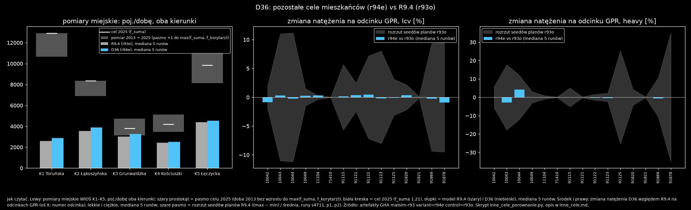

# D36: pozostałe cele GUS dom–X mieszkańców, tylko auto (2026-10-31)

Wariant wybrał użytkownik („Zrób a”, opcja A z [popyt_brak.md](../g_pomiary_miejskie/popyt_brak.md)). Liczby pochodzą z [inne_cele_porownanie.json](inne_cele_porownanie.json), skrypt to `inne_cele_porownanie.py`.

**Zmiana:** `plans.py` z `errand_other = on` (`config/kutno.toml`, `pipeline/errands.py` OTHER; `off` = R9.4 bajt w bajt). Osobne wyjścia jak zakupy D32 (home → cel → home, tylko kierowcy, losowanie z `errand_seed`):

| typ | cel | czas postoju | stawka GUS (łódzkie, wyjścia dom–X) |
|---|---|---:|---:|
| `visit` odwiedziny | budynki mieszkalne | 1 h 28 min | 70 062 |
| `leisure` rekreacja | kultura, sport, gastronomia (BDOT) | 1 h 36 min | 90 163 |
| `health` zdrowie | ochrona zdrowia, szpital, apteka | 57 min | 78 397 |
| `escort` podwożenie | najbliższa szkoła podstawowa, przedszkole, żłobek | 5 min | 146 725 |

Stawki: GUS Mobilność 2024, tabl. 10, na 2 146 153 osób 6+, razy udział kierowcy `errand_car_share` 0,424, razy próbka. Czasy: GUS Budżet czasu 2023, tabl. 1 (życie towarzyskie, sport i rekreacja).

**ZAŁOŻENIA:** (1) czas dla zdrowia jak dla zakupów (brak kategorii); (2) uczestnicy i godziny jak w D32; (3) cel w Kutnie, bez zależności od odległości; (4) udziały z GUS dotyczą wszystkich środków, stosujemy je do kierowców; (5) postój po pracy D35 bierze tylko zakupy i usługi.

Na planie 25% p0 jest 766 nowych wyjść (292 escort, 179 leisure, 156 health, 139 visit).

## Test GHA

- **Estymacja O-D:** run `matsim-od` 41198861640 (job `run (1)` ponowiony raz po przejściowym błędzie zapisu eventów, ERRORS 35). **0 flag** w 6 macierzach. Sumy względem R9.4 (`r93o`): lekkie 47 845,4 vs 47 845,2 (p0), 47 464,9 vs 47 465,4 (p1), 47 887,6 vs 47 888,3 (p2), czyli ≤ 0,002%; ciężkie identyczne.
- **Plany:** p0–p2 (seed 4711/1/2, `errand_seed` 32/33/34, `errand_other=on`), walidacja `ok: true`.
- **Test:** run `matsim-r93` 41200518829, variant = r94e, control = r93o, 25% × 50 iteracji, po 5 runów (seedy 4711/1/2 na p0 oraz plany p1 i p2). 10/10 jobów przeszło za pierwszym razem.

| miara | D36 (r94e) | R9.4 (r93o) | rozrzut planów r93o |
|---|---:|---:|---:|
| stuck | 0 | 0 | – |
| linki przepełnione > 2× | 0 (jeden link w s4711: 1) | 0 | – |
| nogi car = plany | tak (27 233) | tak (25 701) | – |
| opóźnienie, poj.-h (próbka, mediana 5 runów) | 243,8 | 236,5 | 17,8 |
| GPR lekkie w ±15% | 15/15 | 15/15 | – |
| GPR ciężkie w ±15% | 14/15 (poza: 91878, −15,1%) | 13/15 | – |
| zmiana natężenia na odcinku GPR, mediana / maks., lekkie | 0,24% / 0,92% | – | 5,5% |
| zmiana natężenia na odcinku GPR, mediana / maks., ciężkie | 0,0% / 4,17% | – | 4,7% |
| odcinki GPR ponad rozrzut planów | 0 lekkie, 0 ciężkie | – | – |
| podróże pracujących autem: liczba / czas / dystans | 7 478 / 17,15 min / 11,11 km | 7 478 / 17,13 min / 11,11 km | 0,26 min |
| zawrotki na starcie lub końcu trasy, % podróży | 14,3 (start 9,3, koniec 5,0) | 13,5 (8,9 / 4,6) | – |
| pomiary miejskie WIOŚ, suma K1–K5, % celu 2025 | **43,6** | 40,9 | – |

Podróże osobnych wyjść wg typu celu (auto, próbka 25%, mediana 5 runów):

| typ | podróże | czas | dystans |
|---|---:|---:|---:|
| zakupy (`shop`) | 1 320 (R9.4: 1 320) | 6,30 min | 2,53 km |
| usługi (`service`) | 102 (102) | 5,36 min | 2,02 km |
| odwiedziny (`visit`) | 278 | 7,49 min | 3,36 km |
| rekreacja (`leisure`) | 358 | 6,87 min | 2,95 km |
| zdrowie (`health`) | 312 | 7,34 min | 2,61 km |
| podwożenie (`escort`) | 584 | 4,04 min | 1,21 km |

Pomiary miejskie, model w pojazdach na dobę (oba kierunki, mediana 5 runów):

| punkt | cel 2025 | R9.4 | D36 | R9.4, % celu | D36, % celu | zmiana | rozrzut planów |
|---|---:|---:|---:|---:|---:|---:|---:|
| K1 Toruńska | 12 910 | 2 584 | 2 876 | 20,0 | 22,3 | +11,3% | 7,8% |
| K2 Łąkoszyńska | 8 367 | 3 564 | 3 884 | 42,6 | 46,4 | +9,0% | 9,3% |
| K3 Grunwaldzka | 3 805 | 3 028 | 3 280 | 79,6 | 86,2 | +8,3% | 9,8% |
| K4 Kościuszki | 4 208 | 2 432 | 2 500 | 57,8 | 59,4 | +2,8% | 5,8% |
| K5 Łęczycka | 9 850 | 4 384 | 4 536 | 44,5 | 46,0 | +3,5% | 8,0% |
| suma | 39 140 | | | 40,9 | **43,6** | | |

## Wnioski

- **Liczba nóg car rośnie dokładnie o dodane wyjścia:** 25 701 → 27 233 (+1 532 = 2 × 766). Zakupy i usługi są nietknięte (1 320 i 102 podróży).
- **Ruch na drogach z GPR się nie zmienia ponad rozrzut planów.** Maks. zmiana to 0,92% (lekkie) i 4,17% (ciężkie) przy rozrzucie 5,5% i 4,7%, żaden odcinek nie przekracza rozrzutu. Dopasowanie do GPR zostaje (lekkie 15/15, ciężkie 14/15 wobec 13/15; odcinek 91878 przy granicy, −15,1%).
- **Opóźnienie rośnie o 7,3 poj.-h (+3,1%), a rozrzut planów to 17,8.** Zmiana mieści się w rozrzucie. Udział przyczyn zmienia się nieznacznie (pojemność 17 → 22%, spillback 38 → 33%); wniosku z tego nie wyciągam.
- **Czas i dystans podróży pracujących bez zmian** (17,15 vs 17,13 min), bo grupa jest ta sama.
- **Zawrotki +0,8 pp** (13,5 → 14,3%); zmiana jest mała w liczbach bezwzględnych, a przyczyn w danych nie sprawdzałem.
- **K1–K5: +2,7 pp (40,9 → 43,6% celu).** Na K1 (+11,3%) zmiana jest ponad rozrzut planów (7,8%), na K2–K5 w rozrzucie. Luka na ulicach miejskich zostaje (K1 22%, reszta 46–86%), zgodnie z D37 to znane ograniczenie.
- **Porównanie z przewidywaniem bez MATSim** ([popyt_brak.md](../g_pomiary_miejskie/popyt_brak.md)): przy udziale kierowcy 0,424 (jak w teście) przewidywanie daje 40,9 → 44,2% (+3,3 pp; w popyt_brak.md 44,7% dotyczy udziału 0,479). Test GHA daje 43,6% (+2,7 pp), czyli ok. 80% przewidywanego przyrostu. Różnica może wynikać z tras liczonych po czasie swobodnym w przewidywaniu (na K3 i K4 rozjeżdżają się z symulacją) i z jednej realizacji losowania; nie badałem tego dalej (D37).

## Wykres `inne_cele_porownanie.png`

Jak czytać wykres:

- **Lewy panel:** pomiary miejskie K1–K5 w pojazdach na dobę, oba kierunki.
  - Szary prostokąt to pasmo celu 2025: od doby z 2013 r. (bez wzrostu) do większego z dwóch celów (f_suma albo f korytarza).
  - Biała kreska to cel 2025 z f_suma = 1,21.
  - Słupki: szary to R9.4 (r93o), niebieski to D36 (r94e), mediana 5 runów.
- **Środkowy i prawy panel:** zmiana natężenia D36 względem R9.4 na odcinkach GPR (oś pozioma: numer odcinka), w %, osobno lekkie i ciężkie.
  - Niebieskie słupki to mediana 5 runów.
  - Szare pasmo to rozrzut seedów planów kontroli r93o ((max − min) / średnia z runów s4711, p1, p2).
- **Źródło:** artefakty GHA `r94e-<r94e|r93o>-<run>` z runu 41200518829, pobrane do `output/r94e_gha/`.

## Odtworzenie

1. `plans.py scenarios/kutno_od/plans_k1_r94e.xml.gz 0.25 … errand_other=on`, potem workflow `matsim-od` z `tag=r94e` i `plans=plans_k1_r94e.xml.gz` (run 41198861640). Macierze `background_od_r94e{,_p1,_p2}_{lcv,heavy}_gpr.csv` w `scenarios/kutno/demand/`, ostrzeżenia w [od_r94e](od_r94e/).
2. Plany p0–p2 dla n = 0, 1, 2: `plans.py scenarios/kutno/plans_g3r94e[p<n>]_25pct.xml.gz 0.25 seed=<4711|1|2> errand_seed=32+n errand_other=on background_od=…r94e[_pn]_lcv_gpr.csv heavy_od=…r94e[_pn]_heavy_gpr.csv`. Kopie w `scenarios/kutno_r91/{plans,vehicles,meta}_r94e_p{0,1,2}`. Walidacja: `validate_p{0,1,2}`.
3. Workflow `matsim-r93` z `variant=r94e`, `control=r93o` (run 41200518829). Pobranie: `gh run download 41200518829 -n r94e-<v>-<id> -D output/r94e_gha/r94e-<v>-<id>`. Na koniec `inne_cele_porownanie.py`.

Baza projektu zostaje R9.4 (`errand_other = "off"`); decyzja o bazie należy do użytkownika.
