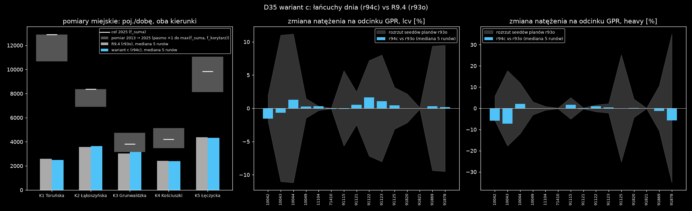

# D35 wariant c: łańcuchy dnia pracujących, tylko auto (2026-10-31)

Wariant wybrał użytkownik („5: zrób wariant c”). Liczby pochodzą z [lancuchy_porownanie.json](lancuchy_porownanie.json), skrypt to `lancuchy_porownanie.py`.

**Zmiana:** `plans.py` z `chains = "on"` (`config/kutno.toml`, osobny generator `chain_seed`; `off` = R9.4 bajt w bajt):

| łańcuch | udział pracujących mieszkańców | źródło |
|---|---:|---|
| dom → podwiezienie (`escort`, 5 min) → praca → dom | 4,634% | GUS Mobilność 2024, tabl. 10, łódzkie: podwożenie–praca 33 866 / dom–praca 730 740 |
| dom → praca → zakupy lub usługi → dom | 4,566% | (dom–praca − praca–dom 661 460) / dom–praca × udział zakupów i usług wśród celów dom–inne (357 974 / 743 321) |

- Postój po pracy przejmuje cel i typ jednego z osobnych wyjść na zakupy (D32), a to wyjście znika. Łączna liczba zakupów i usług zostaje zgodna z GUS.
- Na planie 25% p0 jest 100 podwiezień i 99 postojów po pracy (94 zakupy, 5 usług). Osobnych wyjść jest 612 zamiast 711.

**ZAŁOŻENIA:**

1. Udziały z GUS dotyczą wszystkich środków transportu, a stosujemy je do kierowców.
2. Dziecko jedzie do szkoły podstawowej najbliższej domu (BDOT10k). Danych o rejonach szkół nie ma. Mediana dom–szkoła to 0,38 km.
3. Postój przy szkole trwa 5 min (bez źródła).
4. Sklep po pracy jest wylosowany tak jak w D32, niezależnie od miejsca pracy. Mediana praca–sklep to 4 km.
5. Pominięte zostają podwożenie bez pracy (dom → podwożenie → dom) oraz łańcuchy przyjeżdżających.

## Test GHA

- **Estymacja O-D:** run `matsim-od` 41185108918, 0 flag w 6 macierzach. Sumy względem R9.4: +0,02% (lekkie), 0% (ciężkie).
- **Test:** run `matsim-r93` 41186041250, variant = r94c, control = r93o, 25% × 50 iteracji, po 5 runów (seedy 4711/1/2 na p0 oraz plany p1 i p2). Wszystkie 10 jobów przeszło za pierwszym razem.

| miara | wariant c (r94c) | R9.4 (r93o) | rozrzut planów r93o |
|---|---:|---:|---:|
| stuck, linki przepełnione > 2× | 0 | 0 | – |
| nogi car = plany | tak (25 704) | tak (25 701) | – |
| opóźnienie, poj.-h (próbka, mediana 5 runów) | 232,7 | 236,5 | 17,8 |
| GPR lekkie w ±15% | 15/15 | 15/15 | – |
| GPR ciężkie w ±15% | 14/15 | 13/15 | – |
| zmiana natężenia na odcinku GPR, mediana / maks., lekkie | 0,32% / 1,65% | – | 5,5% |
| zmiana natężenia na odcinku GPR, mediana / maks., ciężkie | 0,49% / 7,25% | – | 4,7% |
| podróże pracujących autem (z łańcuchami): liczba w próbce / czas / dystans | 7 677 / 16,81 min / 10,87 km | 7 478 / 17,13 min / 11,11 km | 0,26 min |
| osobne wyjścia na zakupy i usługi: liczba / czas / dystans | 1 224 / 6,19 min / 2,49 km | 1 422 / 6,20 min / 2,49 km | – |
| podróże do i z podwiezienia: liczba / czas / dystans | 200 / 8,85 min / 3,52 km | – | – |
| podróże do i z postoju po pracy: liczba / czas / dystans | 198 / 9,69 min / 4,07 km | – | – |
| zawrotki na starcie lub końcu trasy, % podróży | 13,5 | 13,5 | – |
| pomiary miejskie WIOŚ, suma K1–K5, % celu 2025 | 40,9 | 40,9 | – |

**Wnioski:**

- **Ruch się nie zmienia ponad rozrzut seedów planów:** na przekrojach GPR, w opóźnieniu i na 5 przekrojach miejskich (zmiany od −3,1% do +3,8% przy rozrzucie 5,8–9,8%).
- **Skąd spadek czasu podróży pracujących (17,13 → 16,81 min).** To wynik innego składu tej grupy, nie szybszej jazdy. Dochodzą krótkie przejazdy dom → szkoła, a przejazdy szkoła → praca i praca → sklep dzielą dawny dojazd na dwie części.
- **Odcinki formalnie „ponad rozrzut”** to 71410 lekkie (−0,1%) i 10042 ciężkie (−5,9%). Na obu rozrzut jest bliski zera, a zmiana jest mała w liczbach bezwzględnych.
- **Łańcuchy zmieniają strukturę dnia, nie ilość ruchu.** Dodają ok. 200 krótkich przejazdów na 25% (ok. 800 na dobę na 100%) i zamieniają 99 osobnych wyjść na postoje. Wariant c przygotowuje populację pod krok 5 (tryby), ale nie wyjaśnia braku ruchu w mieście (patrz niżej).

## Pomiary miejskie (WIOŚ 2013 → 2025, S1)

Metoda: [wios2013.py](../g_pomiary_miejskie/wios2013.py), `pipeline/pomiary_miejskie.py`.

- Cel 2025 to doba z 2013 r. × f_suma = 1,21 (suma korytarzy DK wokół Kutna, GPR 2010/2015/2025).
- Model to oba kierunki, wszystkie pojazdy, mediana 5 runów, przeliczone ze zdarzeń × 1/próbka.

| punkt | cel 2025 | cel wg korytarza | R9.4 | wariant c | R9.4, % celu |
|---|---:|---:|---:|---:|---:|
| K1 Toruńska | 12 910 | 9 644 | 2 584 | 2 504 | 20,0 |
| K2 Łąkoszyńska | 8 367 | 8 367 | 3 564 | 3 652 | 42,6 |
| K3 Grunwaldzka | 3 805 | 4 744 | 3 028 | 3 144 | 79,6 |
| K4 Kościuszki | 4 208 | 5 127 | 2 432 | 2 392 | 57,8 |
| K5 Łęczycka | 9 850 | 11 072 | 4 384 | 4 320 | 44,5 |
| suma | 39 141 | | | | **40,9** |

**Co z tego wynika:**

- **Model ma ok. 41% ruchu zmierzonego na ulicach miejskich.** Na przekrojach GPR (drogi krajowe i wojewódzkie, do których dopasowane jest tło) zgadza się w ±15%. Brak dotyczy więc ruchu wewnątrz miasta. Składa się na niego popyt, którego model nie ma: cele inne niż praca i zakupy (odwiedziny, rekreacja, zdrowie, podwożenie bez pracy), dostawy w mieście i ruch zewnętrzny kończący się w mieście. Pomiar jednodobowy ma rozrzut ok. ±35% (K1: 7,6–15,3 tys.), więc to wynik rzędu wielkości.
- **Kolejność ulic się nie zgadza.** W pomiarze Toruńska ma najwięcej ruchu (K1 > K5 > K2 > K4 > K3), w modelu jest prawie najmniej. Możliwe przyczyny:
  - przyjeżdżający z zachodu jadą obwodnicą zamiast Toruńską (prędkości i grupy dróg D23);
  - w 2013 r. Toruńską jechał ruch DK92 do Krośniewic, który po otwarciu A1 przeszedł na autostradę. Korytarz 91123 spadł z 8 269 (2010) do 5 989 (2015), a z wzrostem dla korytarza cel K1 wynosi 9 644 zamiast 12 910;
  - punkt pomiaru leży przy zachodniej granicy miasta, gdzie mieszkańców jest mniej.
- **Grunwaldzka (K3) jest najbliżej celu (80%).** Zakupy i łańcuchy dokładają tam najwięcej (+3,8%).

## Do decyzji

1. **Czy wariant c staje się bazą R9.5?** W ruchu jest neutralny. Daje strukturę dnia potrzebną w kroku 5 (tryby: podwożenie jako `ride`, postoje po pracy).
2. **Co dalej z brakiem ruchu w mieście:**
   - (a) dodać pozostałe cele GUS „dom–inne” (odwiedziny, rekreacja, zdrowie, podwożenie) jako wyjścia jak w D32;
   - (b) najpierw sprawdzić trasę zachodnich wjazdów na K1 (obwodnica czy Toruńska) — **sprawdzone 2026-10-31, odrzucone** ([k1_zachod.md](../g_pomiary_miejskie/k1_zachod.md));
   - (c) zostawić do kroku 5–6 i kalibracji.

## Wykres `lancuchy_porownanie.png`

Jak czytać wykres:

- **Lewy panel:** pomiary miejskie K1–K5 w pojazdach na dobę, oba kierunki.
  - Szary prostokąt to pasmo celu 2025: od doby z 2013 r. (bez wzrostu) do większego z dwóch celów (f_suma albo f korytarza).
  - Biała kreska to cel 2025 z f_suma = 1,21.
  - Słupki: szary to R9.4, niebieski to wariant c (mediana 5 runów).
- **Środkowy i prawy panel:** zmiana natężenia wariantu c względem R9.4 na odcinkach GPR (oś pozioma: numer odcinka), w %, osobno dla lekkich i ciężkich.
  - Niebieskie słupki to mediana 5 runów.
  - Szare pasmo to rozrzut seedów planów kontroli r93o ((max − min) / średnia z runów s4711, p1, p2).
- **Źródło:** artefakty GHA `r94c-<r94c|r93o>-<run>` z runu 41186041250, pobrane do `output/r94c_gha/`.

## Odtworzenie

1. `plans.py scenarios/kutno_od/plans_k1_r94c.xml.gz 0.25 background_od= heavy_od= chains=on`, potem workflow `matsim-od` z `tag=r94c` i `plans=plans_k1_r94c.xml.gz`.
2. Plany p0–p2 dla n = 0, 1, 2. Polecenie: `plans.py ... 0.25 seed=<4711|1|2> errand_seed=32+n chains=on chain_seed=35+n background_od=…r94c[_pn]_lcv… heavy_od=…r94c[_pn]_heavy…`. Kopie trafiają do `scenarios/kutno_r91/{plans,vehicles,meta}_r94c_p{0,1,2}`. Walidacja: `validate_p{0,1,2}`.
3. Workflow `matsim-r93` z `variant=r94c` i `control=r93o`. Pobranie wyników: `gh run download 41186041250 -n r94c-<v>-<id> -D output/r94c_gha/r94c-<v>-<id>`. Na koniec `lancuchy_porownanie.py`.
