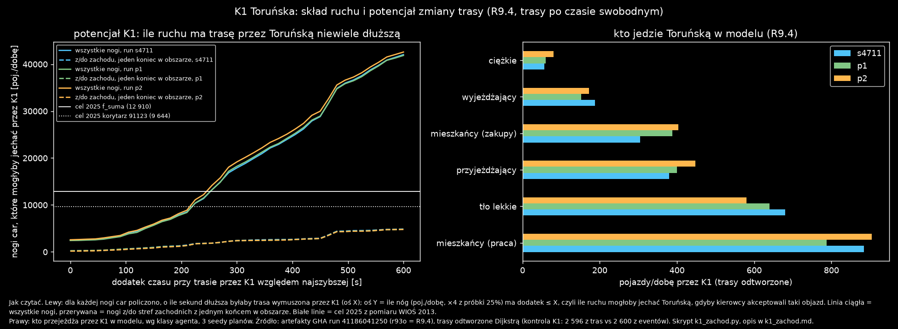
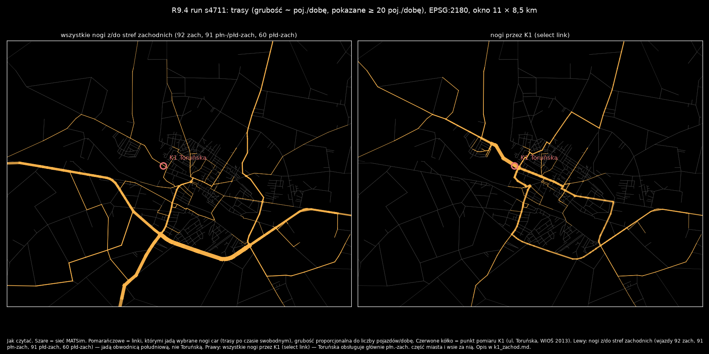

# K1 Toruńska: czy ruch z zachodu omija Toruńską? (opcja b, 2026-10-31)

Opcja (b) z [lancuchy.md](../g_lancuchy/lancuchy.md) („Do decyzji” pkt 2), wybrana przez użytkownika. W R9.4 K1 ma 20% celu 2025 (2 584 wobec 12 910 poj./dobę). W pomiarze WIOŚ 2013 to najbardziej obciążona z pięciu ulic, w modelu prawie najmniej.

**Pytanie:** czy przyjeżdżający z zachodu (DK92 od Krośniewic, DK91, DK60 od Łęczycy) jadą w modelu obwodnicą zamiast Toruńską? Jeśli tak i jeśli różnica czasu jest mała, przyczyną braku ruchu na K1 byłby wybór trasy (prędkości D23, sieć), a nie popyt.

Skrypt: [k1_zachod.py](k1_zachod.py), wyniki liczbowe: [k1_zachod.json](k1_zachod.json).

## Metoda

- **Dane:** runy R9.4 (`r93o`) z testu GHA 41186041250, trzy seedy planów (s4711, p1, p2), 25% × 50 iteracji.
- **Trasy:** artefakty nie zawierają eventów. Trasy wszystkich nóg car z `output_legs` odtworzyłem algorytmem Dijkstry po czasie swobodnym (długość / freespeed + 1 s na link), bez zakazów skrętu.
- **Kontrola przybliżenia:** na K1 trasy dają 2 596 / 2 528 / 2 720 poj./dobę, a eventy tych samych runów 2 600 / 2 508 / 2 712. Różnica jest poniżej 1%. Na K3 i K4 trasy różnią się od eventów o +35% i −14% (kongestia i uczenie w MATSim), więc przybliżenie jest dobre tylko dla K1.
- **Dodatek czasu:** dla każdej nogi liczę dodatek = czas najszybszej trasy wymuszonej przez K1 (w dowolnym kierunku) − czas trasy najszybszej. To miara tego, ile kierowca musiałby nadłożyć, żeby jechać Toruńską.
- **Strefy zachodnie:** wjazdy i wyjazdy 92 zach, 91 płn-zach, 91 płd-zach i 60 płd-zach (`border_zones.csv`).

## Wyniki (3 seedy planów)

**1. Ruch z zachodu nie ma powodu jechać Toruńską.**

| | s4711 | p1 | p2 |
|---|---:|---:|---:|
| nogi z/do stref zachodnich z jednym końcem w obszarze, poj./dobę | 7 620 | 7 436 | 7 344 |
| w tym przez K1 | 3,0% | 3,3% | 2,2% |
| mediana dodatku czasu przez K1 dla tych nóg | 479 s | 479 s | 479 s |
| tranzyt zachód–inna strefa, poj./dobę | 3 892 | 4 152 | 4 164 |

- Ruch z zachodu wjeżdża DK92 i DK60 na obwodnicę południową (mapa, lewy panel).
- Trasa przez Toruńską oznacza dla niego objazd rzędu 8 min.
- To geometria sieci, nie drobna różnica prędkości, którą mogłyby przestawić grupy D23.

**2. Nawet hojna zmiana tras nie zbliża K1 do celu.** Tabela pokazuje, ile pojazdów na dobę mogłoby przejechać przez K1, gdyby wszyscy kierowcy z dodatkiem czasu ≤ X jechali Toruńską (wszystkie nogi):

| dodatek ≤ | 0 s (obecnie) | 60 s | 120 s | 180 s | 300 s |
|---|---:|---:|---:|---:|---:|
| s4711 | 2 492 | 2 820 | 4 440 | 7 120 | 17 908 |
| p1 | 2 428 | 2 720 | 4 156 | 6 924 | 18 248 |
| p2 | 2 588 | 2 988 | 4 588 | 7 224 | 19 184 |

- Do celu 9 644 (wariant korytarzowy) potrzeba ok. 220 s objazdu, do 12 910 ok. 250 s. Oznacza to, że każdy kierowca, który traci na Toruńskiej mniej niż ok. 4 min, musiałby ją wybrać.
- Ani kierowcy, ani MATSim tak nie wybierają. Realistyczne pasmo (≤ 60 s) dodaje 300–400 poj./dobę.

**3. Kto jedzie Toruńską w modelu (poj./dobę):**

| klasa agenta | s4711 | p1 | p2 |
|---|---:|---:|---:|
| mieszkańcy, podróże do pracy | 884 | 788 | 904 |
| mieszkańcy, zakupy | 304 | 388 | 404 |
| przyjeżdżający do pracy | 380 | 400 | 448 |
| tło lekkie | 680 | 640 | 580 |
| wyjeżdżający | 188 | 152 | 172 |
| ciężkie | 56 | 60 | 80 |

- Toruńska obsługuje w modelu północno-zachodnią część miasta i wsie za nią (mapa, prawy panel).
- Udział ciężkich na K1 wynosi w modelu 2–3%, a w pomiarze z 2013 r. 19,4%, czyli ok. 2 000 ciężkich na dobę.
- Model nie ma żadnego źródła takiego ruchu ciężkiego na tej ulicy. Nie wiem, czy ten ruch nadal istnieje: brak danych o tym, dokąd jechał w 2013 r.

## Wnioski

1. **Hipoteza (b) odrzucona.** Brak ruchu na K1 nie wynika z wyboru trasy przyjeżdżających z zachodu. Zmiana prędkości albo sieci przy Toruńskiej nie jest uzasadniona.
2. **Brakuje popytu w obszarze, który obsługuje Toruńska**, czyli w północno-zachodnich osiedlach i wsiach za granicą miasta. Kandydaci:
   - cele mieszkańców inne niż praca i zakupy (odwiedziny, rekreacja, zdrowie, podwożenie bez pracy);
   - przyjazdy spoza miasta w celach innych niż praca (zakupy, usługi, szkoła). Model ma z zewnątrz tylko dojazdy do pracy z macierzy GUS;
   - ruch ciężki z 2013 r. (19,4%), którego model nie odtwarza.
3. **Rząd wielkości (szacunek, nie wynik modelu):**
   - Wg GUS Mobilność 2024 (tabl. 10, łódzkie) cele „dom–inne” poza zakupami i usługami to 385 347 podróży wobec 730 740 „dom–praca”, czyli ok. 53%.
   - Na K1 jedzie ok. 1 200 mieszkańców. Gdyby inne cele dodały ok. połowy ich podróży do pracy (przy podobnym udziale auta), przybyłoby kilkaset pojazdów na dobę.
   - Same cele mieszkańców (opcja a) nie zamkną więc luki ok. 7–10 tys. poj./dobę. Ważniejsi mogą być przyjeżdżający spoza miasta w celach innych niż praca i ruch ciężki.
4. **K1 waży jedną trzecią sumy celu** (12 910 z 39 141). Bez K1 model R9.4 ma na K2–K5 13 408 z 26 230 poj./dobę, czyli 51% celu, a nie 41%. Pomiar z jednej doby w 2013 r. ma rozrzut ok. ±35%, więc K1 to wynik rzędu wielkości.

## Rekomendacje

1. **Nie zmieniać sieci ani prędkości przy Toruńskiej.** Zamknąć opcję (b).
2. **Następny krok: pomiar przed wdrożeniem**, tak jak przy odległości celu.
   - Policzyć analitycznie, bez MATSim, ile pojazdów dodałyby na K1–K5 dwie grupy: (i) pozostałe cele mieszkańców wg GUS i (ii) przyjazdy z gmin powiatu w celach innych niż praca.
   - Trasy liczyć tym samym narzędziem co tutaj (Dijkstra, kontrola na K1 < 1%).
   - Wyniki przedstawić z wariantami do wyboru.
3. **W walidacji miejskiej raportować osobno K1 i sumę K2–K5.** K1 nie powinien sam sterować decyzjami, dopóki nie wiadomo, skąd był ruch ciężki z 2013 r.

## Wykres `k1_zachod.png`

Jak czytać wykres:

- **Lewy panel:**
  - Oś X: dodatek czasu (s), jaki miałaby noga car, gdyby musiała przejechać przez K1, względem swojej najszybszej trasy.
  - Oś Y: liczba nóg z dodatkiem ≤ X w pojazdach na dobę (próbka 25% × 4), czyli ruch, który mógłby jechać Toruńską przy akceptacji takiego objazdu.
  - Linie ciągłe to wszystkie nogi, przerywane to nogi z/do stref zachodnich z jednym końcem w obszarze. Kolory oznaczają seedy planów (s4711 niebieski, p1 zielony, p2 pomarańczowy).
  - Białe poziome linie to cel 2025: ciągła z f_suma (12 910), kropkowana z korytarza 91123 (9 644).
- **Prawy panel:** pojazdy na dobę przez K1 w modelu wg klasy agenta, trzy seedy planów.
- **Źródło:** artefakty GHA run 41186041250 (`output/r94c_gha/r94c-r93o-*`), trasy odtworzone Dijkstrą.
- Opis jest też wpisany pod wykresem w PNG.

## Wykres `k1_zachod_mapa.png`

Jak czytać wykres:

- Szare linie to sieć MATSim. Pomarańczowe to linki, którymi jadą wybrane nogi car (trasy po czasie swobodnym, run s4711), a grubość jest proporcjonalna do liczby pojazdów na dobę. Pokazane są linki z co najmniej 20 poj./dobę.
- Czerwone kółko to punkt K1 (ul. Toruńska 7, WIOŚ 2013).
- **Lewy panel:** nogi z/do stref zachodnich. Jadą obwodnicą południową (DK92 i DK60), a nie Toruńską.
- **Prawy panel:** wszystkie nogi przez K1 (select link). Toruńska zbiera ruch z płn.-zach. części miasta i wsi za nią.
- Okno 11 × 8,5 km, EPSG:2180, bez osi (współrzędne nieistotne). Opis jest też wpisany pod mapą w PNG.

## Ograniczenia

- Trasy liczone są po czasie swobodnym. Na K1 zgadzają się z eventami (< 1%), na K3 i K4 nie (kongestia), więc wnioski dotyczą tylko K1.
- Bez zakazów skrętu (D26). Ich efekt jest poniżej rozrzutu seedów.
- Szacunek w pkt 3 wniosków to rachunek rzędu wielkości, nie wynik symulacji.

## Odtworzenie

`uv run python -W ignore reports/etap3/g_pomiary_miejskie/k1_zachod.py`. Wymaga artefaktów `output/r94c_gha/r94c-r93o-{s4711,p1,p2}` z runu 41186041250. Czas ok. 30 s.
