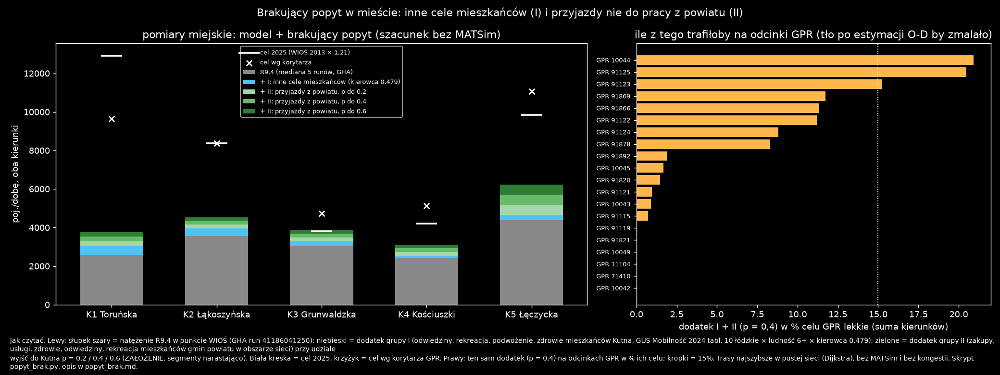

# Brakujący popyt w mieście: pomiar przed wdrożeniem (2026-10-31)

Punkt 2 rekomendacji z [k1_zachod.md](k1_zachod.md), zlecony przez użytkownika („Zrób te pomiary z pkt 2”).

**Pytanie:** ile pojazdów na dobę dodałyby na przekrojach miejskich K1–K5 dwie grupy popytu, których R9.4 nie ma? Czy to zamyka lukę do celu 2025 (model 40,9%)?

- **Grupa I:** mieszkańcy Kutna, cele spoza modelu: odwiedziny, rekreacja, podwożenie bez pracy, zdrowie.
- **Grupa II:** mieszkańcy pozostałych gmin powiatu kutnowskiego (część w obszarze sieci) jadący do Kutna nie do pracy: zakupy, usługi, zdrowie, odwiedziny, rekreacja.

Liczone bez MATSim. Skrypt: [popyt_brak.py](popyt_brak.py), liczby: [popyt_brak.json](popyt_brak.json).

## Metoda

- **Liczba wyjść z domu:**
  - Stawka na osobę 6+ wg GUS Mobilność 2024: tabl. 10 (podróże dom–X, łódzkie) podzielona przez osoby 6+ z tabl. 4 (2 146 153).
  - Mnożymy ją przez ludność 6+ i udział kierowcy auta.
  - Każde wyjście to 2 podróże (tam i z powrotem), jak w D32.

| cel (GUS tabl. 10, łódzkie) | podróży dom–X | na osobę 6+ | grupa |
|---|---:|---:|---|
| odwiedziny | 70 062 | 0,0327 | I, II |
| rekreacja / rozrywka / hobby | 90 163 | 0,0420 | I, II |
| podwożenie / odprowadzanie | 146 725 | 0,0684 | I |
| świadczenia medyczne | 78 397 | 0,0365 | I, II |
| zakupy w centrach handlowych | 102 892 | 0,0479 | II (mieszkańcy Kutna już w D32) |
| inne zakupy | 229 380 | 0,1069 | II |
| usługi | 25 702 | 0,0120 | II |

- **Ludność:**
  - Kutno: 40 232 osoby 6+ (`population_kutno.csv`).
  - Gminy powiatu: BREC NSP 2021. Ludność 6+ to ogółem minus 6/18 grupy 0–17. Bierzemy tylko część gminy w obszarze sieci, wg kubatury budynków mieszkalnych. Razem 48 207 osób 6+.
- **Domy:** budynki BDOT10k jedno- i wielorodzinne, waga obrys × kondygnacje (jak D28).
- **Cele w Kutnie, losowane z wagą (jak D32):**
  - zakupy: sklepy OSM (D34);
  - usługi: jak `errands.py`;
  - zdrowie: placówka ochrony zdrowia, szpital, apteka;
  - odwiedziny: budynki mieszkalne;
  - rekreacja: dom kultury, obiekty sportowe, basen, teatr, muzeum, biblioteka, restauracja, dom weselny;
  - podwożenie: najbliższa szkoła podstawowa, przedszkole lub żłobek (jak D35).
- **Trasy:** najszybsze w pustej sieci (Dijkstra). Test „link na trasie”: t(o→a) + t(link) + t(b→d) = t(o→d). Na K1 to przybliżenie zgadza się z eventami (< 1%, [k1_zachod.md](k1_zachod.md)). Na K3 i K4 nie, bo pomija kongestię.

**ZAŁOŻENIA (warianty):**

1. **Udział kierowcy auta:**
   - 0,424 (jak zakupy D32);
   - 0,479 (GUS tabl. 13, łódzkie: podróże jako kierowca 1 894 401 / wszystkie 3 958 088).
2. **p:** udział wyjść nie do pracy mieszkańców gmin powiatu, które kończą się w Kutnie. Danych brak, warianty 0,2 / 0,4 / 0,6.
3. Wszystkie cele grupy I leżą w Kutnie (górna granica dla ulic miejskich).
4. Grupa II bez podwożenia i szkoły (krok 4B) oraz bez gmin spoza powiatu. Ruch z dalszych gmin wjeżdża drogami z GPR i siedzi już w tle.

## Wyniki

**Dodatek przy kierowcy = 1 i p = 1 (poj./dobę, oba kierunki):**

| | K1 | K2 | K3 | K4 | K5 |
|---|---:|---:|---:|---:|---:|
| I (7 177 wyjść) | 975 | 836 | 513 | 244 | 547 |
| II (13 318 wyjść) | 2 490 | 2 010 | 2 166 | 1 977 | 5 541 |

**Model + dodatek, % celu 2025 (kierowca 0,479):**

| wariant | K1 | K2 | K3 | K4 | K5 | suma K1–K5 | suma K2–K5 |
|---|---:|---:|---:|---:|---:|---:|---:|
| R9.4 | 20,0 | 42,6 | 79,6 | 57,8 | 44,5 | 40,9 | 51,1 |
| + I | 23,6 | 47,4 | 86,0 | 60,6 | 47,2 | 44,7 | 54,6 |
| + I + II, p = 0,2 | 25,5 | 49,7 | 91,5 | 65,1 | 52,6 | 48,1 | 59,3 |
| + I + II, p = 0,4 | 27,3 | 52,0 | 96,9 | 69,6 | 57,9 | 51,6 | 63,6 |
| + I + II, p = 0,6 | 29,2 | 54,3 | 102,4 | 74,1 | 63,3 | 55,1 | 67,8 |

Przy kierowcy 0,424 sumy są niższe o 0,8–1,6 pp (np. p = 0,4: 50,4% i 62,1%).

**Skąd na K1 przyjeżdżają ludzie z grupy II** (p = 1, kierowca = 1): Nowe Ostrowy 858, gm. w. Kutno 579, Łanięta 543, Strzelce 205 poj./dobę. To wsie na północny zachód od miasta, czyli zlewnia Toruńskiej z [k1_zachod.md](k1_zachod.md).

**Odcinki GPR** (dodatek I + II przy p = 0,4, kierowca 0,479):
- mediana 1,6% celu lekkich;
- najwięcej 10044 (20,9%), 91125 (20,5%), 91123 (15,3%), 91869, 91866, 91122 (11–12%).

Ten ruch jest już częściowo w tle, które jest dopasowane do GPR. Po ponownej estymacji O-D tło na tych drogach zmaleje, więc dodatek na K2–K5 przy wjazdach (K5 Łęczycka, K2 Łąkoszyńska) jest górną granicą.

## Wnioski

1. **Żadna z grup nie zamyka luki.**
   - Grupa I (dane GUS, bez wolnych parametrów) podnosi sumę K1–K5 z 40,9% do 44,7%.
   - Z grupą II przy hojnym p = 0,6 suma rośnie do ok. 55%, a K2–K5 do 68%.
2. **K1 zostaje na 24–29% celu w każdym wariancie.** Nowy popyt jedzie przez Toruńską, ale w ilości rzędu setek pojazdów, a brakuje ok. 9 tys. K1 jest więc niewyjaśniony popytem osobowym z danych GUS. W 2013 r. 19,4% ruchu na K1 stanowiły ciężkie, a punkt mógł mieć wtedy inną rolę w sieci. Bez danych tego nie rozstrzygniemy.
3. **K3 Grunwaldzka przekracza cel** już przy p = 0,4–0,6 (97–102%), a K1 i K2 zostają daleko. Równe dokładanie popytu nie poprawi kolejności ulic. Problemem jest też rozkład celów i tras, nie tylko ich liczba.
4. **Czego pomiar nie obejmuje:**
   - podróży niezaczynających się w domu (praca–inne, inne–inne; szacunek z tabl. 10: ok. 13% wszystkich, po odjęciu dom–X i powrotów);
   - ruchu służbowego i dostawczego wewnątrz miasta (badanie GUS obejmuje gospodarstwa domowe, więc go nie ma);
   - szkoły (4B);
   - zmiany ruchu miejskiego 2013–2025 innej niż S1.

   To kandydaci na resztę luki, ale bez danych liczbowych.

## Propozycje do wyboru

| opcja | co robimy | efekt wg pomiaru | koszt i ryzyko |
|---|---|---|---|
| **A (polecam)** | Wdrożyć grupę I jak D32: osobne wyjścia mieszkańców, cele wg tabeli wyżej (D36). Test GHA jak zawsze. | +3,8 pp sumy, wszystkie punkty w górę o 3–6 pp. Parametry tylko z GUS. | Mały: generator jak `errands.py`. Grupa I to też podstawa pod tryby (krok 5). |
| B | A + grupa II z p jako ZAŁOŻENIEM (np. 0,4), plus ponowna estymacja O-D tła. | Do ok. 52% sumy i 64% K2–K5. K3 bliżej przekroczenia. | Średni: nowa klasa agentów spoza miasta. p nie ma źródła, a tło na GPR się zmieni. |
| C | Nic teraz, przejść do szkoły (4B) i trybów (5). Lukę miejską zapisać jako ograniczenie. | 40,9% bez zmian. | Zero. Luka wraca przy kalibracji w kroku 6. |

Niezależnie od opcji:
- K1 traktować w walidacji osobno (pkt 2 wniosków);
- głównym wskaźnikiem miejskim robić sumę K2–K5.

## Wykres `popyt_brak.png`

Jak czytać wykres:

- **Lewy panel:** dla każdego punktu WIOŚ pojazdy na dobę w obu kierunkach.
  - Szary słupek: R9.4, mediana 5 runów GHA 41186041250.
  - Niebieski: dodatek grupy I (kierowca 0,479).
  - Trzy odcienie zieleni: dodatek grupy II narastająco, do p = 0,2, 0,4 i 0,6. Szczyt najciemniejszego segmentu to wariant p = 0,6.
  - Biała pozioma kreska: cel 2025 (WIOŚ 2013 × 1,21). Krzyżyk: cel wg korytarza GPR.
- **Prawy panel:** dodatek I + II (p = 0,4) na odcinkach GPR w % celu lekkich (suma kierunków). Kropkowana linia to 15%. Odcinki z dużym dodatkiem to te, na których po ponownej estymacji O-D zmalałoby tło.
- **Źródło:** GUS Mobilność 2024 tabl. 4, 10, 13; BREC NSP 2021; BDOT10k; sklepy OSM; sieć R9.4.
- Trasy najszybsze w pustej sieci, bez kongestii. Opis jest też wpisany pod wykresem w PNG.

## Odtworzenie

`uv run python -W ignore reports/etap3/g_pomiary_miejskie/popyt_brak.py` (ok. 90 s, seed 2026).
- Wymaga `output/r94c_gha/r94c-r93o-s4711/` (sieć i `analiza/gpr_lcv.csv`) oraz `reports/etap3/g_lancuchy/lancuchy_porownanie.json`.
- Log: `popyt_brak.log`.
