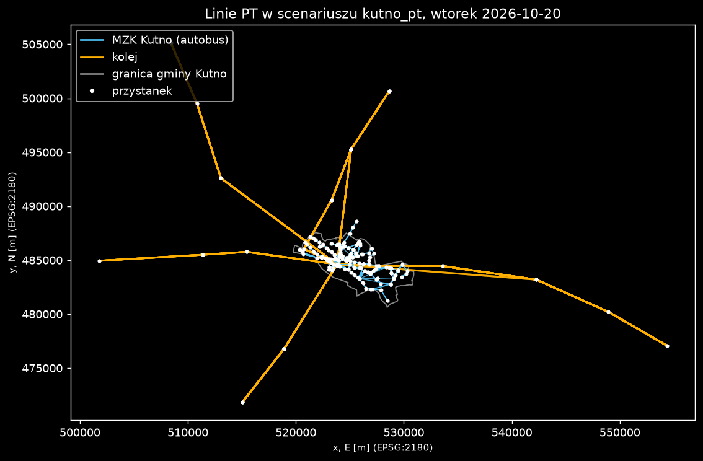

# Krok 5 (część techniczna): import GTFS do MATSim, `scenarios/kutno_pt/`

Zakres: tylko wejścia PT (rozkład, pojazdy, sieć z linkami PT). Bez wyboru trybu i bez zmian w popycie, configach `scenarios/kutno/*.xml`, `config/kutno.toml`, `pipeline/plans.py`, `pipeline/errands.py`.

## Narzędzie i powód wyboru

`org.matsim.application.prepare.pt.CreateTransitScheduleFromGtfs` (CLI `transit-from-gtfs`, contrib application) jest w jarze (`unzip -l`: klasa z 2026-04-10; stary `GtfsConverter` z contrib gtfs też jest, 2024-12-05). Wybrałem pierwszą: przyjmuje wiele feedów naraz (`--prefix`), datę (`--date`), `--target-crs`, scala linki PT z siecią bazową i waliduje wynik. Polecenia `prepare transit-from-gtfs` **nie ma** w `java -jar … --help` (runner pokazuje tylko `run`/`gui`), więc klasę uruchamiam przez `java -cp <jar> <klasa>` (`--help` działa, opcje potwierdzone).

Odtworzenie (Git Bash, korzeń repo; `ROOT` = katalog z `data/raw`, `scenarios/kutno/network.xml.gz` i jarem):

```bash
ROOT=<katalog> sh pipeline/build_kutno_pt.sh
```

Skrypt: (1) `pipeline/pt_filter_gtfs.py` filtruje kolej do dnia i bbox, wynik do katalogu tymczasowego (`data/raw` bez zmian), (2) konwerter dla `kutno.zip` + przefiltrowanej kolei, `--date 2026-10-20`, `--target-crs EPSG:2180`, `--pseudo-network singleLinkBetweenStops`, (3) zmiana nazw plików.

## Decyzje

- **Dzień typowy: wtorek 2026-10-20 (ZAŁOŻENIE, jak w G4).** MZK: `calendar_dates` ma tego dnia serwis `RO` (feed 2026-10-01–12-31). Kolej: feed ważny 2026-10-17–11-16 (`feed_info.txt`), 71 wpisów `calendar_dates` na ten dzień.
- **Autobusy jadą po pseudo-linkach PT (`pt_*`), nie po sieci samochodowej.** Powód: najprostsze, działa bez dopasowania tras do sieci OSM (brak pt2matsim). Skutek: autobus nie stoi w korkach i nie obciąża jezdni, czas przejazdu wynika z rozkładu. Dla Kutna (mały ruch) to akceptowalne, ale to uproszczenie.
- **Kolej: filtr w Pythonie.** Zostają kursy aktywne tego dnia z ≥ 2 przystankami w bbox sieci (`scenarios/kutno/area/network_area.wkt`: x 499 062–555 162, y 468 460–506 157, EPSG:2180). Kurs jest przycięty do odcinka między pierwszym i ostatnim przystankiem w bbox. Efekt uboczny: wszystkie 112 zostawionych kursów zatrzymuje się w Kutnie (stacja `32201`), bo tylko Kutno jest gęsto w bbox.
- Sieć wyjściowa `network_pt.xml.gz` = sieć bazowa `scenarios/kutno/network.xml.gz` + 398 linków `pt_*` (razem 10 781 linków). Plik sieci bazowej nie jest zmieniany (wersja PT to osobny plik).
- Pliki są małe (razem ok. 410 kB), więc idą do gita, bez wpisu w `.gitignore`.

## Liczby

| | MZK (autobus) | kolej | razem |
|---|---|---|---|
| linie | 13 | 9 | 22 |
| kursy (odjazdy) = pojazdy | 334 | 112 | 446 |
| przystanki (stopFacility) | 312 | 86 | 398 |
| trasy (transitRoute) | 89 | 93 | 182 |
| linki PT | | | 398 |

Kursy na linię: MZK 1: 36, 2: 12, 3: 29, 4: 25, 5: 22, 6: 22, 7: 27, 8: 14, 9: 38, 10: 30, 11: 14, 12: 32, 14: 33 (brak linii 13 w GTFS). Kolej: ŁKA 58, R31 18, REG 18, PKM2 6, RE3 4, RE31 4, IC 2, KW 1, PKM1 1.

Źródło liczb: `reports/etap3/g_pt_import/wyniki_testow.txt` (generuje `test_pt_import.py`). Jeden przystanek GTFS daje w MATSim po kilka `stopFacility` (po jednym na link w pseudo-sieci), stąd 398 `stopFacility` (312 MZK, 86 kolej).

## Testy

`uv run python reports/etap3/g_pt_import/test_pt_import.py --raw <ROOT>/data/raw` (kod wyjścia 0 = komplet zaliczony). Wynik: wszystkie testy OK.

| test | wynik |
|---|---|
| linie MZK w schedule = linie GTFS aktywne tego dnia (policzone niezależnie z `data/raw`) | 13 = 13 |
| kursy MZK = kursy GTFS aktywne tego dnia | 334 = 334 |
| linie i kursy kolei = wynik filtra z surowego feedu | 9 = 9, 112 = 112 |
| wszystkie przystanki w bbox sieci, x 5xx xxx, y 4xx xxx | 398/398 |
| każdy przystanek ma `linkRefId` istniejący w sieci | 398/398 |
| każda trasa ma ciąg linków połączony (`to` linku i = `from` linku i+1) | 182/182 |
| przystanki trasy leżą na jej linkach, w kolejności jazdy | 182/182 |
| offsety czasów w profilu trasy niemalejące | 182/182 |
| odjazdy w trasie: unikalne czasy, okno 0–30 h | 446 odjazdów, 0 błędów |
| każdy `vehicleRefId` istnieje w `transitVehicles`, 1 pojazd na kurs | 446 = 446 |

**Test 2 iteracji na GTFS (osobny mini-scenariusz `scenarios/kutno_pt/mini/`).** 2 agentów z nogami `pt` (p1: autobus w Kutnie, p2: kolej Kutno → ok. 10 km na wschód), `transit.useTransit=true`, SwissRailRaptor (dodawany przez runner automatycznie), `lastIteration=1`. Czas ok. 17 s. Polecenie (z korzenia repo):

```bash
java -Xmx3g -jar matsim/matsim-example-project-0.0.1-SNAPSHOT.jar run --config scenarios/kutno_pt/mini/config.xml --post-processing disabled
```

Wynik: SwissRailRaptor wczytał 182 trasy, 446 odjazdów, 398 przystanków; 446 `TransitDriverStarts`; 0 `personStuck`; 4/4 nogi `walk-pt-walk` (p1: autobus MZK, wsiadanie na przystanku `mzk_4`, wysiadanie `mzk_7`, po południu `mzk_1.1` → `mzk_3`; p2: pociąg ze stacji Kutno rano 33 min, po południu 91 min, z czego 82 min to oczekiwanie na pociąg). Klasa Java nie była dodawana ani zmieniana, jar nie był przebudowywany, więc smoke regresyjny nie był potrzebny.

## Mapa



### Jak czytać wykres

- Osie: x = easting, y = northing w metrach, EPSG:2180 (tak jak sieć MATSim), skala równa na obu osiach.
- Niebieskie linie: trasy MZK Kutno (autobus); pomarańczowe: kolej; szara obwiednia: granica gminy Kutno (`scenarios/kutno/area/gmina.geojson`); białe kropki: przystanki z `transitSchedule.xml.gz`.
- Linie narysowane są jako proste odcinki między kolejnymi przystankami trasy, nie według geometrii torów/dróg (w pseudo-sieci nie ma geometrii pośredniej). Kolej wychodzi w 5 kierunków, bo bbox obejmuje całą sieć (powiat), a przystanki spoza niej są odcięte.
- Źródło liczb: `transitSchedule.xml.gz` (współrzędne przystanków) i `gmina.geojson`; skrypt `test_pt_import.py`.

## Znane ograniczenia

- **Licencje.** MZK: GTFS z agregatora zbiorkom.live, licencja potwierdzona przez użytkownika (patrz zadanie), ale feed nie jest oficjalny i GTFS-RT od 2026-10-01 nieaktualizowany; ważny tylko do 2026-12-31. Kolej: feed Kuranowskiego z danych PLK/KM; dalsze użycie wymaga zachowania atrybucji z `attributions.txt` (nie weryfikowałem warunków poza `docs/research/G4_tryby.md`). Do `docs/ZRODLA.md` i manifestu danych wpisuje sesja główna.
- **Ważność feedu kolejowego**: 2026-10-17–11-16, jeden miesiąc; potem rozkład trzeba pobrać ponownie i ewentualnie zmienić dzień.
- **Brak PKS i autobusów międzygminnych** (nie ma GTFS), więc dojazdy do gmin powiatu bez kolei nie mają alternatywy PT.
- **Pseudo-sieć:** autobusy nie jadą po jezdniach OSM, więc nie ma interakcji z ruchem ani geometrii dróg; `Infinity m/s` w ostrzeżeniach walidatora (np. linia 3, przystanki Raszewska Pętla → Raszewska / Zachodnia) to pary przystanków w tym samym punkcie czasowym o różnych współrzędnych (293 m, 244 m, 440 m), czyli rozkład nie pozwala na dojazd w czasie 0 s; MATSim sam wymusza minimalny czas na pseudo-linku. Link `pt_0` ma długość 0.
- **Ujemny `arrivalOffset` na 1. przystanku (naprawione 2026-10-31).** Było 62 trasy kolejowe (−18 s do −6 min). Przyczyna: `pt_filter_gtfs.py` przycina kurs do bbox sieci, a nowy pierwszy przystanek zachowywał postój z rozkładu (przyjazd przed odjazdem); konwerter liczy offsety od odjazdu, więc przyjazd wychodził ujemny. Końce rozkładu nie były zamienione: wszystkie 67 kursów z postojem to kursy przycięte z przodu, nieprzycięte nie mają postoju na 1. przystanku. Filtr ustawia teraz przyjazd = odjazd na nowym pierwszym i odjazd = przyjazd na nowym ostatnim przystanku. Skutek uboczny: prędkość pseudo-linku pierwszego odcinka liczona bez postoju (np. `pt_11` 23,7 → 25,5 m/s). Test sprawdza to jako warunek (na starym rozkładzie zgłasza 62).
- **Kolej przycięta do bbox sieci** (przystanki poza bbox usunięte), czyli pociągi kończą bieg na krawędzi bbox. Przesiadki w Kutnie (autobus ↔ pociąg) zależą od odległości przystanków; `transfers.txt` nie jest używany. Wczytywane dojście do przystanku to teleportowany walk w SwissRailRaptor (domyślne ustawienia, nieskalibrowane).
- Jedna doba (wtorek) powielona na wszystkie dni modelu; weekendy bez PT nie są odwzorowane.
- Pojazdy mają typy domyślne konwertera (`Bus_veh_type`: 50 miejsc + 100 stojących, `RE_RB_veh_type` itd.), nieskalibrowane, nie wynikają z danych MZK.
- Popyt na PT i wybór trybu nie wchodzą w zakres tego kroku. Kolejny krok (do decyzji sesji głównej): podpięcie `network_pt.xml.gz` + schedule do configu dużego scenariusza, `SubtourModeChoice` i scoring PT (w tym darmowe przejazdy z Kartą Mieszkańca) oraz run na GitHub Actions.
