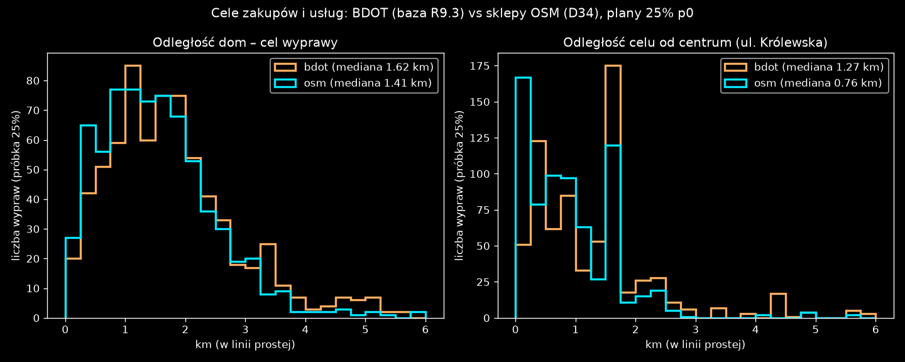

# D34: cel zakupów według sklepów OSM (wariant (a)+(c), 2026-10-30)

Wariant wybrał użytkownik po inspekcji QGIS ([inspekcja.md](../inspekcja_qgis/inspekcja.md)). Liczby pochodzą z [cel_osm.json](cel_osm.json), wykres z `cel_osm.py`.

**Zmiana w kodzie:**

- `pipeline/osm_poi.py` zapisuje sklepy OSM (`shop=*` bez `vacant`, węzły i obszary) z gminy Kutno do `scenarios/kutno/osm/shops.csv`. Jest ich 264.
- `pipeline/errands.py` z `errand_dest = "osm"` (`config/kutno.toml`):
  - Typ c (centra handlowe) to sklepy OSM `supermarket`, `mall` i `department_store`.
  - Typ s (inne zakupy) to pozostałe sklepy, także te na parterach budynków mieszkalnych.
  - Punkt celu to budynek BDOT w odległości do 15 m od sklepu, a gdy takiego nie ma, sam punkt sklepu.
  - Waga budynku to liczba sklepów danego typu w budynku, a nie obrys.
  - Usługi (u) zostają bez zmian, z BDOT.
- `errand_dest = "bdot"` jest domyślne i daje plany R9.3 bajt w bajt (sha256 `efcbe80…` = `scenarios/kutno_r91/plans_r93_p0.xml.gz`).

## Wynik na planach 25% (p0)

Oba warianty mają te same osoby, domy i godziny wyjść. Zmienia się tylko cel.

| | BDOT (R9.3) | OSM (D34) |
|---|---:|---:|
| wyprawy (c / s / u) | 204 / 456 / 51 | 204 / 456 / 51 |
| różne cele c | 5 | 21 |
| największy cel c, % wypraw c | 36,8 (Galeria Różana) | 9,3 |
| 5 największych celów s, % wypraw s | 18,9 | 21,9 |
| mediana odległości celu od centrum, km | 1,27 | 0,76 |
| cele w promieniu 0,5 km od centrum | 24,5% | 34,6% |
| cele s dalej niż 2 km od centrum | 23,5% | 6,6% |
| mediana odległości dom–cel, km | 1,62 | 1,41 |
| wyprawy krótsze niż 1 km | 24,2% | 31,6% |

**Co z tego wynika:**

- Cele przesuwają się do centrum i do sklepów osiedlowych.
- Wyprawy „centrum handlowe” nie skupiają się już w jednej galerii, tylko rozkładają się na 20 supermarketów.
- Największym celem s jest Galeria Różana (10%, około 30 sklepów w jednym budynku).
- Wypraw autem poniżej 1 km jest więcej (31,6%). Z dwóch powodów: model nadal nie wiąże wyboru celu z odległością (punkt otwarty D32), a trybów nie ma.

**ZAŁOŻENIA:**

- Waga to liczba sklepów, nie powierzchnia sprzedaży ani obroty.
- Wariant liczy wszystkie `shop=*`, także `car` i `car_repair`.
- Eurocash to hurtownia, ale w OSM ma tag `supermarket`, więc trafia do c (10 wypraw).
- OSM może być niekompletny. Nie ma źródła zewnętrznego, które by to sprawdziło.

## Test GHA (run 41093715027, 25% × 50 it., 5 runów na wariant: seedy 4711/1/2 na planach p0 oraz p1, p2)

Kontrola to R9.3 (r93) na tej samej platformie. Macierze O-D r93o pochodzą z runu `matsim-od` 41091336824: 0 flag `od_warnings`, sumy −0,02% (lekkie) i 0% (ciężkie) względem r93. Job r93 s4711 za pierwszym razem padł na pobraniu DTD z matsim.org (błąd sieci, ERRORS 35) i przeszedł po ponowieniu. Liczby: [cel_osm_porownanie.json](cel_osm_porownanie.json), wykres [cel_osm_porownanie.png](cel_osm_porownanie.png), skrypt `cel_osm_porownanie.py`.

| miara | D34 (r93o) | R9.3 (r93) | rozrzut planów r93 |
|---|---:|---:|---:|
| stuck, linki przepełnione > 2× | 0 | 0 | – |
| nogi car = plany | tak (25 701) | tak (25 703) | – |
| wyprawy zakupy i usługi: czas jazdy, min | **6,20** | 7,05 | – |
| wyprawy zakupy i usługi: dystans, km | **2,49** | 2,96 | – |
| dojazd do pracy (mieszk., dojeżdż., wyjeżdż.): czas, min | 17,13 | 17,13 | 0,30 |
| opóźnienie, poj.-h (próbka, mediana 5 runów) | 236,5 | 237,4 | 23,6 |
| GPR lekkie w ±15% | 15/15 | 15/15 | – |
| GPR ciężkie w ±15% | 13/15 | 13/15 | – |
| zmiana natężenia na odcinku GPR, mediana / maks., lekkie | 0,35% / 1,56% | – | 5,8% |
| zmiana natężenia na odcinku GPR, mediana / maks., ciężkie | 0,24% / 6,67% | – | 6,6% |
| zawrotki na starcie lub końcu trasy, % podróży | 13,5 | 13,5 | – |

**Wniosek:**

- D34 skraca wyprawy zakupowe o 16% (dystans 2,96 → 2,49 km, czas 7,05 → 6,20 min), bo cele leżą bliżej centrum.
- Na przekrojach GPR, w opóźnieniach i w czasach dojazdu do pracy zmiana mieści się w rozrzucie seedów planów.
- Odcinki ciężkie 91121 i 91122 formalnie wychodzą „ponad rozrzut”, ale ich zmiana to +0,5% i +0,7%, a rozrzut jest tam bliski zera.
- Tak jak w D32, test nie sprawdza ruchu wewnątrz miasta, bo nie ma tam pomiarów. Inwentaryzacja pomiarów: `docs/research/G_pomiary_miejskie.md` (gałąź sesji).

Jak czytać wykres `cel_osm_porownanie.png`:

- **Lewy panel:** mediana udziału podróży z zawrotką na starcie lub na końcu trasy, w % podróży, wg rodzaju agenta (mieszkańcy, dojeżdżający, wyjeżdżający, tło lekkie, tło ciężkie). Szare słupki to R9.3, niebieskie to D34.
- **Środkowy i prawy panel:** zmiana natężenia D34 względem R9.3 na odcinkach GPR (oś pozioma: numer odcinka), w %, osobno dla lekkich i ciężkich. Niebieskie słupki to mediana 5 runów. Szare pasmo to rozrzut seedów planów kontroli r93 ((max − min) / średnia z runów s4711, p1, p2).
- **Źródło:** artefakty GHA `r93o-<r93o|r93>-<run>`, pobrane do `output/r93o_gha/`.

## Odtworzenie

1. Push i workflow `matsim-od` z `tag=r93o`, `compare=` (puste) i `plans=plans_k1_r93o.xml.gz`. Wynikiem są macierze `background_od_r93o*`.
2. Plany p0–p2: `plans.py ... errand_dest=osm seed=n errand_seed=32+n background_od=...r93o[_pn]_lcv... heavy_od=...`, zapis do `scenarios/kutno_r91/{plans,vehicles,meta}_r93o_p{0,1,2}`.
3. Workflow `matsim-r93` (variant=r93o, control=r93): 5 runów r93o i 5 runów r93. Pobranie: `gh run download 41093715027 -n r93o-<r93o|r93>-<s4711|s1|s2|p1|p2> -D output/r93o_gha/r93o-<v>-<id>`, potem `uv run python -W ignore reports/etap3/g_zakupy/cel_osm/cel_osm_porownanie.py`.

## Wykres `cel_osm.png`

Jak czytać wykres:

- **Lewy panel:** histogram odległości w linii prostej od domu do celu wyprawy, w koszykach co 0,25 km, do 6 km.
- **Prawy panel:** histogram odległości celu od centrum. Za centrum przyjęto medianę współrzędnych sklepów OSM, która wypada przy ul. Królewskiej.
- **Oś pozioma:** km. **Oś pionowa:** liczba wypraw w próbce 25% (711 wypraw, wszystkie typy razem).
- **Kolory:** pomarańczowy to BDOT (baza R9.3), turkusowy to sklepy OSM (D34). W legendzie podana jest mediana.
- **Źródło liczb:** `output/r93o/{bdot,osm}_p0_errands.csv` z `plans.py` (25%, seed 4711, `errand_seed` 32).
