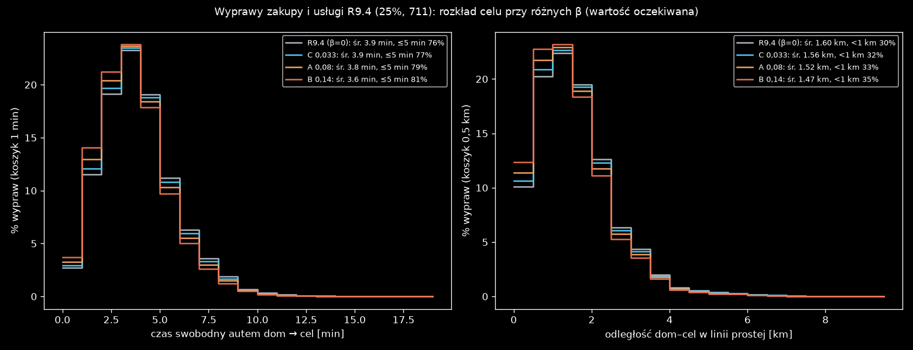

# Odległość w wyborze celu wypraw: pomiar wariantów A/B/C na planach R9.4 (2026-10-31)

Warianty pochodzą z [G_odleglosc_celu.md](../../../../docs/research/G_odleglosc_celu.md). Waga celu to W_j · exp(−β · t_ij), gdzie t_ij to czas swobodny autem z sieci w minutach.

| wariant | β [1/min] | źródło |
|---|---|---|
| A | 0,08 | KBR Szczecin 2016, tab. 3, dom–inne (jednostka minut to ZAŁOŻENIE) |
| B | 0,14 | własne dopasowanie do GBR 2022, rys. 53 |
| C | 0,033 | odpowiednik τ = 30 min z tła |

**Jak liczone.** Nowych planów nie generowałem. Dla każdej z 711 wypraw w `plans_g3r94_25pct_errands.csv` wziąłem dom i pulę celów danego typu (c, s, u, ta sama pula co `errands.draw`). Policzyłem czas swobodny do każdego celu, tak samo jak `plans.py` (od końca linku domu do początku linku celu, plus przejazd linku celu). Potem wyznaczyłem rozkład wyboru celu i jego wartości oczekiwane. Skrypt: `pomiar_beta.py`, liczby w `pomiar_beta.json`.

**Kontrola.** Przy β = 0 wynik powinien się zgadzać z obecnymi planami i się zgadza: średnio 1,60 km wobec 1,56 km w faktycznym losowaniu, a wypraw poniżej 1 km jest 30,4% wobec 31,7%.

## Wynik

| | R9.4 (β = 0) | C 0,033 | A 0,08 | B 0,14 | GBR 2022 dom–inne (kontrola) |
|---|---:|---:|---:|---:|---:|
| średni czas swobodny, min | 3,94 | 3,87 | 3,77 | 3,65 | 18 (rzeczywisty, wszystkie tryby) |
| t ≤ 5 min | 75,8% | 77,0% | 78,7% | 80,6% | 10,9% |
| t ≤ 15 min | 100% | 100% | 100% | 100% | 62,5% |
| średnia odległość dom–cel (linia prosta), km | 1,60 | 1,56 | 1,52 | 1,47 | – |
| wyprawy < 1 km | 30,4% | 31,5% | 33,1% | 35,1% | – |
| wyprawy > 3 km | 8,8% | 8,2% | 7,6% | 6,9% | – |

**Wnioski:**

1. **W Kutnie odległość prawie nie różnicuje celów.** Wszystkie cele są w zasięgu 15 minut jazdy swobodnej, a 76% w zasięgu 5 minut. Nawet najsilniejszy wariant B skraca średni czas tylko o 0,3 min.
2. **Kierunek zmiany jest odwrotny do celu z przeglądu.** Zanik z odległością przesuwa wybór do najbliższych sklepów, więc wypraw autem poniżej 1 km przybywa (30% → 35%). Dalekich (> 3 km) ubywa niewiele.
3. **Rozkładu GBR nie da się tu użyć jako celu.** GBR to Gdańsk, wszystkie tryby i czas rzeczywisty od drzwi do drzwi. W Kutnie czas swobodny autem rzadko przekracza 10 minut.
4. **Za dużo krótkich wypraw autem to sprawa wyboru środka transportu, nie wyboru celu.** Trasę poniżej 1 km w rzeczywistości częściej robi się pieszo. Rozwiąże to krok 5 (tryby), a w wariancie c łańcuch dnia, w którym część zakupów robi się po drodze z pracy.

## Proponowany wybór

| opcja | skutek |
|---|---|
| **(1) Nie wdrażać teraz, zostawić punkt otwarty do kroku 5 (polecam)** | Plany i macierze bez zmian. Zanik wejdzie razem z wyborem trybu, kiedy krótkie trasy dostaną alternatywę pieszą. |
| (2) Wdrożyć A (β = 0,08, Szczecin) dla spójności z tłem | Wymaga nowych planów, estymacji O-D i testu GHA (3 runy workflow). Efekt w ruchu będzie poniżej rozrzutu, bo wyprawy skracają się średnio o 0,13 km, a wypraw < 1 km przybywa (+2,7 pp). |
| (3) Wdrożyć B (β = 0,14) | To samo co (2), z silniejszym efektem w tę samą, niepożądaną stronę (< 1 km: +4,7 pp). |

## Wykres `pomiar_beta.png`

Jak czytać wykres:

- **Lewy panel:** rozkład czasu swobodnego autem od domu do celu, w koszykach co 1 min. Oś pionowa: % z 711 wypraw (wartość oczekiwana rozkładu wyboru, nie pojedyncze losowanie).
- **Prawy panel:** rozkład odległości dom–cel w linii prostej, w koszykach co 0,5 km.
- **Kolory:**
  - szary: R9.4 (β = 0);
  - niebieski: C (0,033);
  - pomarańczowy: A (0,08);
  - czerwony: B (0,14).
- **Legenda:** średnia i udział ≤ 5 min (lewy panel) albo < 1 km (prawy panel).
- **Źródło liczb:** `pomiar_beta.py` na `scenarios/kutno/plans_g3r94_25pct_errands.csv` i `scenarios/kutno/network.xml.gz`.
